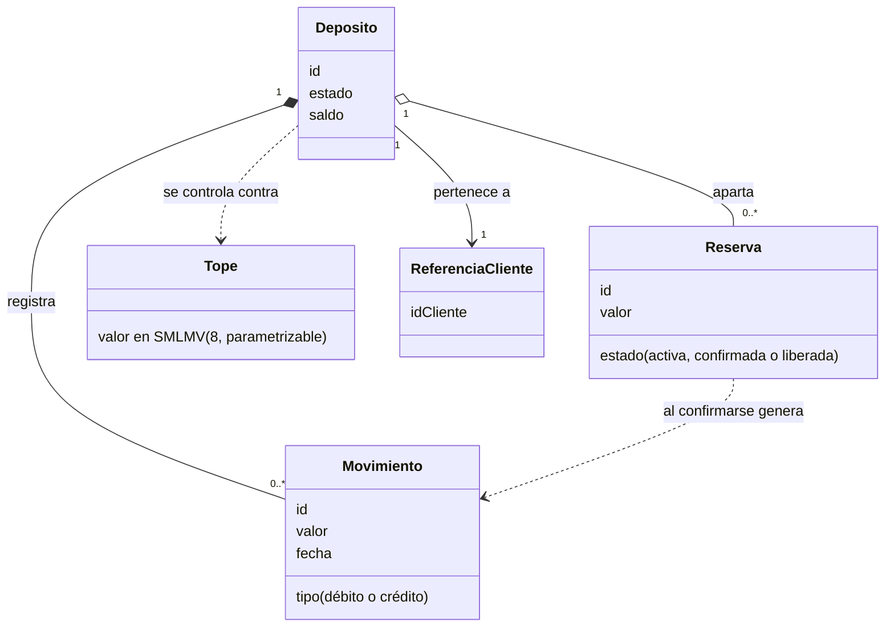

# Diagramas C4

El [modelo C4](https://c4model.com/) describe una aplicación con vistas de menor a mayor detalle: contexto, contenedores, componentes y código. Aquí se usan las tres primeras y, de forma opcional y a alto nivel, la cuarta para un solo componente. Los diagramas se generan **desde un solo modelo** (`modelos/structurizr/kuenta.dsl`), así que son coherentes entre sí.

:::info Dos significados de «contenedor»
En C4, un **contenedor** es algo que se despliega por separado: una aplicación móvil, una base de datos o el monolito. No es lo mismo que un contenedor de Docker. El monolito de Kuenta es un contenedor de C4 y, además, se empaqueta en una imagen de Docker.
:::

## Nivel 1 · Contexto

Kuenta en su entorno: quién la usa y con qué sistemas se conecta. Los sistemas grises son del ecosistema regulado y los dorados son los de apoyo, que se compran y no se diseñan por dentro.

```mermaid
graph LR
  linkStyle default fill:#ffffff

  subgraph diagram ["Nivel 1 · Contexto de Kuenta"]
    style diagram fill:#ffffff,stroke:#ffffff

    1["<div style='font-weight: bold'>Cliente</div><div style='font-size: 70%; margin-top: 0px'>[Persona]</div><div style='font-size: 80%; margin-top:10px'>Persona natural con un<br />depósito de bajo monto</div>"]
    style 1 fill:#1f5fa8,stroke:#154275,color:#ffffff
    10["<div style='font-weight: bold'>Redes de corresponsales</div><div style='font-size: 70%; margin-top: 0px'>[Sistema de software]</div><div style='font-size: 80%; margin-top:10px'>Operan los terminales y<br />concilian con Kuenta</div>"]
    style 10 fill:#8a8f98,stroke:#60646a,color:#ffffff
    11["<div style='font-weight: bold'>Proveedor de notificaciones</div><div style='font-size: 70%; margin-top: 0px'>[Sistema de software]</div><div style='font-size: 80%; margin-top:10px'>Envía mensajes al cliente<br />(SMS, correo, notificación en<br />la app)</div>"]
    style 11 fill:#8a8f98,stroke:#60646a,color:#ffffff
    12["<div style='font-weight: bold'>Sistema contable y de tesorería</div><div style='font-size: 70%; margin-top: 0px'>[Sistema de software]</div><div style='font-size: 80%; margin-top:10px'>Contabilidad general y<br />tesorería (CAP-24)</div>"]
    style 12 fill:#b9a66b,stroke:#81744a,color:#1a1a1a
    13["<div style='font-weight: bold'>Sistema de personas y nómina</div><div style='font-size: 70%; margin-top: 0px'>[Sistema de software]</div><div style='font-size: 80%; margin-top:10px'>Gestión de personas (CAP-26)</div>"]
    style 13 fill:#b9a66b,stroke:#81744a,color:#1a1a1a
    14["<div style='font-weight: bold'>Sistema de compras y proveedores</div><div style='font-size: 70%; margin-top: 0px'>[Sistema de software]</div><div style='font-size: 80%; margin-top:10px'>Gestión de proveedores y<br />terceros (CAP-27)</div>"]
    style 14 fill:#b9a66b,stroke:#81744a,color:#1a1a1a
    15["<div style='font-weight: bold'>Kuenta</div><div style='font-size: 70%; margin-top: 0px'>[Sistema de software]</div><div style='font-size: 80%; margin-top:10px'>Core transaccional: apertura<br />de depósitos, cuentas, pagos,<br />efectivo, cumplimiento y<br />atención</div>"]
    style 15 fill:#0b3d6b,stroke:#072a4a,color:#ffffff
    2["<div style='font-weight: bold'>Corresponsal</div><div style='font-size: 70%; margin-top: 0px'>[Persona]</div><div style='font-size: 80%; margin-top:10px'>Atiende depósitos y retiros<br />de efectivo en su<br />establecimiento</div>"]
    style 2 fill:#1f5fa8,stroke:#154275,color:#ffffff
    3["<div style='font-weight: bold'>Analista de cumplimiento</div><div style='font-size: 70%; margin-top: 0px'>[Persona]</div><div style='font-size: 80%; margin-top:10px'>Revisa lo retenido y decide<br />si se libera o se rechaza</div>"]
    style 3 fill:#1f5fa8,stroke:#154275,color:#ffffff
    4["<div style='font-weight: bold'>Regulador</div><div style='font-size: 70%; margin-top: 0px'>[Persona]</div><div style='font-size: 80%; margin-top:10px'>Recibe reportes y consulta la<br />auditoría</div>"]
    style 4 fill:#1f5fa8,stroke:#154275,color:#ffffff
    5["<div style='font-weight: bold'>Personal de Kuenta</div><div style='font-size: 70%; margin-top: 0px'>[Persona]</div><div style='font-size: 80%; margin-top:10px'>Empleados que usan los<br />sistemas de apoyo</div>"]
    style 5 fill:#1f5fa8,stroke:#154275,color:#ffffff
    6["<div style='font-weight: bold'>Registraduría Nacional (simulada)</div><div style='font-size: 70%; margin-top: 0px'>[Sistema de software]</div><div style='font-size: 80%; margin-top:10px'>Valida la identidad del<br />cliente</div>"]
    style 6 fill:#8a8f98,stroke:#60646a,color:#ffffff
    7["<div style='font-weight: bold'>Proveedor de listas restrictivas</div><div style='font-size: 70%; margin-top: 0px'>[Sistema de software]</div><div style='font-size: 80%; margin-top:10px'>Consulta de listas para<br />SARLAFT</div>"]
    style 7 fill:#8a8f98,stroke:#60646a,color:#ffffff
    8["<div style='font-weight: bold'>Bre-B</div><div style='font-size: 70%; margin-top: 0px'>[Sistema de software]</div><div style='font-size: 80%; margin-top:10px'>Sistema de pagos inmediatos<br />del Banco de la República</div>"]
    style 8 fill:#8a8f98,stroke:#60646a,color:#ffffff
    9["<div style='font-weight: bold'>UIAF y Superintendencia Financiera</div><div style='font-size: 70%; margin-top: 0px'>[Sistema de software]</div><div style='font-size: 80%; margin-top:10px'>Reciben los reportes de<br />operaciones sospechosas y los<br />reportes mínimos</div>"]
    style 9 fill:#8a8f98,stroke:#60646a,color:#ffffff

    1-. "<div>Abre su depósito, transfiere<br />y consulta</div><div style='font-size: 70%'></div>" .->15
    2-. "<div>Registra depósitos y retiros</div><div style='font-size: 70%'></div>" .->15
    3-. "<div>Revisa operaciones retenidas</div><div style='font-size: 70%'></div>" .->15
    4-. "<div>Consulta reportes y auditoría</div><div style='font-size: 70%'></div>" .->15
    5-. "<div>Usa</div><div style='font-size: 70%'></div>" .->13
    5-. "<div>Usa</div><div style='font-size: 70%'></div>" .->14
    13-. "<div>Entrega asientos</div><div style='font-size: 70%'></div>" .->12
    14-. "<div>Entrega asientos</div><div style='font-size: 70%'></div>" .->12
    15-. "<div>Valida la identidad</div><div style='font-size: 70%'></div>" .->6
    15-. "<div>Consulta listas restrictivas</div><div style='font-size: 70%'></div>" .->7
    15-. "<div>Reporta operaciones<br />sospechosas</div><div style='font-size: 70%'></div>" .->9
    15-. "<div>Envía y recibe transferencias</div><div style='font-size: 70%'></div>" .->8
    15-. "<div>Concilia con corresponsales</div><div style='font-size: 70%'></div>" .->10
    15-. "<div>Pide enviar notificaciones</div><div style='font-size: 70%'></div>" .->11
    15-. "<div>Entrega los asientos<br />contables</div><div style='font-size: 70%'></div>" .->12

  end
```

## Nivel 2 · Contenedores

Qué se despliega: tres aplicaciones de acceso, el monolito modular y su base de datos. El monolito es **un solo contenedor** con varias réplicas, y la base de datos es una sola con un esquema por módulo.

```mermaid
graph LR
  linkStyle default fill:#ffffff

  subgraph diagram ["Nivel 2 · Contenedores de Kuenta"]
    style diagram fill:#ffffff,stroke:#ffffff

    1["<div style='font-weight: bold'>Cliente</div><div style='font-size: 70%; margin-top: 0px'>[Persona]</div><div style='font-size: 80%; margin-top:10px'>Persona natural con un<br />depósito de bajo monto</div>"]
    style 1 fill:#1f5fa8,stroke:#154275,color:#ffffff
    2["<div style='font-weight: bold'>Corresponsal</div><div style='font-size: 70%; margin-top: 0px'>[Persona]</div><div style='font-size: 80%; margin-top:10px'>Atiende depósitos y retiros<br />de efectivo en su<br />establecimiento</div>"]
    style 2 fill:#1f5fa8,stroke:#154275,color:#ffffff
    3["<div style='font-weight: bold'>Analista de cumplimiento</div><div style='font-size: 70%; margin-top: 0px'>[Persona]</div><div style='font-size: 80%; margin-top:10px'>Revisa lo retenido y decide<br />si se libera o se rechaza</div>"]
    style 3 fill:#1f5fa8,stroke:#154275,color:#ffffff
    4["<div style='font-weight: bold'>Regulador</div><div style='font-size: 70%; margin-top: 0px'>[Persona]</div><div style='font-size: 80%; margin-top:10px'>Recibe reportes y consulta la<br />auditoría</div>"]
    style 4 fill:#1f5fa8,stroke:#154275,color:#ffffff
    6["<div style='font-weight: bold'>Registraduría Nacional (simulada)</div><div style='font-size: 70%; margin-top: 0px'>[Sistema de software]</div><div style='font-size: 80%; margin-top:10px'>Valida la identidad del<br />cliente</div>"]
    style 6 fill:#8a8f98,stroke:#60646a,color:#ffffff
    7["<div style='font-weight: bold'>Proveedor de listas restrictivas</div><div style='font-size: 70%; margin-top: 0px'>[Sistema de software]</div><div style='font-size: 80%; margin-top:10px'>Consulta de listas para<br />SARLAFT</div>"]
    style 7 fill:#8a8f98,stroke:#60646a,color:#ffffff
    8["<div style='font-weight: bold'>Bre-B</div><div style='font-size: 70%; margin-top: 0px'>[Sistema de software]</div><div style='font-size: 80%; margin-top:10px'>Sistema de pagos inmediatos<br />del Banco de la República</div>"]
    style 8 fill:#8a8f98,stroke:#60646a,color:#ffffff
    9["<div style='font-weight: bold'>UIAF y Superintendencia Financiera</div><div style='font-size: 70%; margin-top: 0px'>[Sistema de software]</div><div style='font-size: 80%; margin-top:10px'>Reciben los reportes de<br />operaciones sospechosas y los<br />reportes mínimos</div>"]
    style 9 fill:#8a8f98,stroke:#60646a,color:#ffffff
    10["<div style='font-weight: bold'>Redes de corresponsales</div><div style='font-size: 70%; margin-top: 0px'>[Sistema de software]</div><div style='font-size: 80%; margin-top:10px'>Operan los terminales y<br />concilian con Kuenta</div>"]
    style 10 fill:#8a8f98,stroke:#60646a,color:#ffffff
    11["<div style='font-weight: bold'>Proveedor de notificaciones</div><div style='font-size: 70%; margin-top: 0px'>[Sistema de software]</div><div style='font-size: 80%; margin-top:10px'>Envía mensajes al cliente<br />(SMS, correo, notificación en<br />la app)</div>"]
    style 11 fill:#8a8f98,stroke:#60646a,color:#ffffff
    12["<div style='font-weight: bold'>Sistema contable y de tesorería</div><div style='font-size: 70%; margin-top: 0px'>[Sistema de software]</div><div style='font-size: 80%; margin-top:10px'>Contabilidad general y<br />tesorería (CAP-24)</div>"]
    style 12 fill:#b9a66b,stroke:#81744a,color:#1a1a1a

    subgraph 15 ["Kuenta"]
      style 15 fill:#ffffff,stroke:#072a4a,color:#072a4a

      16["<div style='font-weight: bold'>Aplicación del cliente</div><div style='font-size: 70%; margin-top: 0px'>[Contenedor: Aplicación móvil]</div><div style='font-size: 80%; margin-top:10px'>Abrir el depósito,<br />transferir, consultar y<br />reclamar</div>"]
      style 16 fill:#3a7bd0,stroke:#285691,color:#ffffff
      17["<div style='font-weight: bold'>Terminal del corresponsal</div><div style='font-size: 70%; margin-top: 0px'>[Contenedor: Aplicación de terminal]</div><div style='font-size: 80%; margin-top:10px'>Registrar depósitos y retiros<br />de efectivo</div>"]
      style 17 fill:#3a7bd0,stroke:#285691,color:#ffffff
      18["<div style='font-weight: bold'>Consola de back office</div><div style='font-size: 70%; margin-top: 0px'>[Contenedor: Aplicación web con MFA]</div><div style='font-size: 80%; margin-top:10px'>Revisión manual, reportes y<br />consulta de auditoría</div>"]
      style 18 fill:#3a7bd0,stroke:#285691,color:#ffffff
      19["<div style='font-weight: bold'>Aplicación Kuenta</div><div style='font-size: 70%; margin-top: 0px'>[Contenedor: Monolito modular]</div><div style='font-size: 80%; margin-top:10px'>Un solo despliegue, varias<br />réplicas. Módulos con datos<br />propios y puertas públicas</div>"]
      style 19 fill:#0b3d6b,stroke:#072a4a,color:#ffffff
      28[("<div style='font-weight: bold'>Base de datos</div><div style='font-size: 70%; margin-top: 0px'>[Contenedor: Base de datos relacional]</div><div style='font-size: 80%; margin-top:10px'>Un esquema por módulo; ningún<br />módulo lee el esquema de otro</div>")]
      style 28 fill:#2e7d5b,stroke:#20573f,color:#ffffff
    end

    16-. "<div>Llama a la API</div><div style='font-size: 70%'>[HTTPS]</div>" .->19
    17-. "<div>Llama a la API</div><div style='font-size: 70%'>[HTTPS]</div>" .->19
    18-. "<div>Llama a la API</div><div style='font-size: 70%'>[HTTPS]</div>" .->19
    1-. "<div>Usa</div><div style='font-size: 70%'></div>" .->16
    2-. "<div>Usa</div><div style='font-size: 70%'></div>" .->17
    3-. "<div>Usa</div><div style='font-size: 70%'></div>" .->18
    4-. "<div>Consulta</div><div style='font-size: 70%'></div>" .->18
    19-. "<div>Lee y escribe</div><div style='font-size: 70%'>[SQL]</div>" .->28
    19-. "<div>Valida la identidad</div><div style='font-size: 70%'></div>" .->6
    19-. "<div>Consulta listas restrictivas</div><div style='font-size: 70%'></div>" .->7
    19-. "<div>Reporta operaciones<br />sospechosas</div><div style='font-size: 70%'></div>" .->9
    19-. "<div>Envía y recibe transferencias</div><div style='font-size: 70%'></div>" .->8
    19-. "<div>Concilia con corresponsales</div><div style='font-size: 70%'></div>" .->10
    19-. "<div>Pide enviar notificaciones</div><div style='font-size: 70%'></div>" .->11
    19-. "<div>Entrega los asientos<br />contables</div><div style='font-size: 70%'></div>" .->12

  end
```

## Nivel 3 · Componentes

El interior del monolito: sus componentes, que en Kuenta son los **ocho módulos**, con sus puertas públicas (cada flecha) y los sistemas externos con los que habla cada uno.

```mermaid
graph LR
  linkStyle default fill:#ffffff

  subgraph diagram ["Nivel 3 · Componentes (módulos) de Kuenta"]
    style diagram fill:#ffffff,stroke:#ffffff

    10["<div style='font-weight: bold'>Redes de corresponsales</div><div style='font-size: 70%; margin-top: 0px'>[Sistema de software]</div><div style='font-size: 80%; margin-top:10px'>Operan los terminales y<br />concilian con Kuenta</div>"]
    style 10 fill:#8a8f98,stroke:#60646a,color:#ffffff
    11["<div style='font-weight: bold'>Proveedor de notificaciones</div><div style='font-size: 70%; margin-top: 0px'>[Sistema de software]</div><div style='font-size: 80%; margin-top:10px'>Envía mensajes al cliente<br />(SMS, correo, notificación en<br />la app)</div>"]
    style 11 fill:#8a8f98,stroke:#60646a,color:#ffffff
    12["<div style='font-weight: bold'>Sistema contable y de tesorería</div><div style='font-size: 70%; margin-top: 0px'>[Sistema de software]</div><div style='font-size: 80%; margin-top:10px'>Contabilidad general y<br />tesorería (CAP-24)</div>"]
    style 12 fill:#b9a66b,stroke:#81744a,color:#1a1a1a
    6["<div style='font-weight: bold'>Registraduría Nacional (simulada)</div><div style='font-size: 70%; margin-top: 0px'>[Sistema de software]</div><div style='font-size: 80%; margin-top:10px'>Valida la identidad del<br />cliente</div>"]
    style 6 fill:#8a8f98,stroke:#60646a,color:#ffffff
    7["<div style='font-weight: bold'>Proveedor de listas restrictivas</div><div style='font-size: 70%; margin-top: 0px'>[Sistema de software]</div><div style='font-size: 80%; margin-top:10px'>Consulta de listas para<br />SARLAFT</div>"]
    style 7 fill:#8a8f98,stroke:#60646a,color:#ffffff
    8["<div style='font-weight: bold'>Bre-B</div><div style='font-size: 70%; margin-top: 0px'>[Sistema de software]</div><div style='font-size: 80%; margin-top:10px'>Sistema de pagos inmediatos<br />del Banco de la República</div>"]
    style 8 fill:#8a8f98,stroke:#60646a,color:#ffffff
    9["<div style='font-weight: bold'>UIAF y Superintendencia Financiera</div><div style='font-size: 70%; margin-top: 0px'>[Sistema de software]</div><div style='font-size: 80%; margin-top:10px'>Reciben los reportes de<br />operaciones sospechosas y los<br />reportes mínimos</div>"]
    style 9 fill:#8a8f98,stroke:#60646a,color:#ffffff

    subgraph 15 ["Kuenta"]
      style 15 fill:#ffffff,stroke:#072a4a,color:#072a4a

      subgraph 19 ["Aplicación Kuenta"]
        style 19 fill:#ffffff,stroke:#072a4a,color:#072a4a

        20["<div style='font-weight: bold'>Identidad y apertura</div><div style='font-size: 70%; margin-top: 0px'>[Módulo]</div><div style='font-size: 80%; margin-top:10px'>CAP-01 a 03: registrar,<br />verificar identidad, mantener<br />datos del cliente</div>"]
        style 20 fill:#ffffff,stroke:#444444,color:#444444
        21["<div style='font-weight: bold'>Cuentas y depósitos</div><div style='font-size: 70%; margin-top: 0px'>[Módulo]</div><div style='font-size: 80%; margin-top:10px'>CAP-04 a 08: depósitos,<br />topes, libro mayor, GMF,<br />inactivos</div>"]
        style 21 fill:#ffffff,stroke:#444444,color:#444444
        22["<div style='font-weight: bold'>Pagos y transferencias</div><div style='font-size: 70%; margin-top: 0px'>[Módulo]</div><div style='font-size: 80%; margin-top:10px'>CAP-09 a 11: entre cuentas,<br />Bre-B, conciliación</div>"]
        style 22 fill:#ffffff,stroke:#444444,color:#444444
        23["<div style='font-weight: bold'>Efectivo y corresponsales</div><div style='font-size: 70%; margin-top: 0px'>[Módulo]</div><div style='font-size: 80%; margin-top:10px'>CAP-12 a 14: depositar,<br />retirar, red de<br />corresponsales</div>"]
        style 23 fill:#ffffff,stroke:#444444,color:#444444
        24["<div style='font-weight: bold'>Cumplimiento y riesgo</div><div style='font-size: 70%; margin-top: 0px'>[Módulo]</div><div style='font-size: 80%; margin-top:10px'>CAP-15 a 17: listas,<br />antifraude, reportes</div>"]
        style 24 fill:#ffffff,stroke:#444444,color:#444444
        25["<div style='font-weight: bold'>Atención al cliente</div><div style='font-size: 70%; margin-top: 0px'>[Módulo]</div><div style='font-size: 80%; margin-top:10px'>CAP-20 a 23: tarifas,<br />consultas, extractos, quejas,<br />avisos</div>"]
        style 25 fill:#ffffff,stroke:#444444,color:#444444
        26["<div style='font-weight: bold'>Notificaciones</div><div style='font-size: 70%; margin-top: 0px'>[Módulo]</div><div style='font-size: 80%; margin-top:10px'>CAP-19: avisar al cliente</div>"]
        style 26 fill:#ffffff,stroke:#444444,color:#444444
        27["<div style='font-weight: bold'>Auditoría</div><div style='font-size: 70%; margin-top: 0px'>[Módulo]</div><div style='font-size: 80%; margin-top:10px'>CAP-18: registro de cada<br />operación, solo se agrega</div>"]
        style 27 fill:#ffffff,stroke:#444444,color:#444444
      end

      16["<div style='font-weight: bold'>Aplicación del cliente</div><div style='font-size: 70%; margin-top: 0px'>[Contenedor: Aplicación móvil]</div><div style='font-size: 80%; margin-top:10px'>Abrir el depósito,<br />transferir, consultar y<br />reclamar</div>"]
      style 16 fill:#3a7bd0,stroke:#285691,color:#ffffff
      17["<div style='font-weight: bold'>Terminal del corresponsal</div><div style='font-size: 70%; margin-top: 0px'>[Contenedor: Aplicación de terminal]</div><div style='font-size: 80%; margin-top:10px'>Registrar depósitos y retiros<br />de efectivo</div>"]
      style 17 fill:#3a7bd0,stroke:#285691,color:#ffffff
      18["<div style='font-weight: bold'>Consola de back office</div><div style='font-size: 70%; margin-top: 0px'>[Contenedor: Aplicación web con MFA]</div><div style='font-size: 80%; margin-top:10px'>Revisión manual, reportes y<br />consulta de auditoría</div>"]
      style 18 fill:#3a7bd0,stroke:#285691,color:#ffffff
    end

    16-. "<div>Registra al cliente</div><div style='font-size: 70%'>[HTTPS]</div>" .->20
    16-. "<div>Consulta saldo</div><div style='font-size: 70%'>[HTTPS]</div>" .->21
    16-. "<div>Solicita transferencias</div><div style='font-size: 70%'>[HTTPS]</div>" .->22
    16-. "<div>Consulta, reclama</div><div style='font-size: 70%'>[HTTPS]</div>" .->25
    17-. "<div>Autoriza y confirma depósitos<br />y retiros</div><div style='font-size: 70%'>[HTTPS]</div>" .->23
    18-. "<div>Revisión manual y reportes</div><div style='font-size: 70%'>[HTTPS]</div>" .->24
    18-. "<div>Consulta la auditoría</div><div style='font-size: 70%'>[HTTPS]</div>" .->27
    20-. "<div>Valida la identidad</div><div style='font-size: 70%'></div>" .->6
    24-. "<div>Consulta listas restrictivas</div><div style='font-size: 70%'></div>" .->7
    24-. "<div>Reporta operaciones<br />sospechosas</div><div style='font-size: 70%'></div>" .->9
    22-. "<div>Envía y recibe transferencias</div><div style='font-size: 70%'></div>" .->8
    23-. "<div>Concilia con corresponsales</div><div style='font-size: 70%'></div>" .->10
    26-. "<div>Pide enviar notificaciones</div><div style='font-size: 70%'></div>" .->11
    21-. "<div>Entrega los asientos<br />contables</div><div style='font-size: 70%'></div>" .->12
    20-. "<div>Pide crear el depósito</div><div style='font-size: 70%'></div>" .->21
    20-. "<div>Pide consultar listas</div><div style='font-size: 70%'></div>" .->24
    22-. "<div>Reserva, debita y acredita</div><div style='font-size: 70%'></div>" .->21
    22-. "<div>Pide revisión antifraude</div><div style='font-size: 70%'></div>" .->24
    23-. "<div>Autoriza, debita y acredita</div><div style='font-size: 70%'></div>" .->21
    23-. "<div>Pide revisión antifraude</div><div style='font-size: 70%'></div>" .->24
    25-. "<div>Consulta saldo y movimientos</div><div style='font-size: 70%'></div>" .->21
    20-. "<div>Publica evento</div><div style='font-size: 70%'></div>" .->26
    21-. "<div>Publica evento</div><div style='font-size: 70%'></div>" .->26
    22-. "<div>Publica evento</div><div style='font-size: 70%'></div>" .->26
    23-. "<div>Publica evento</div><div style='font-size: 70%'></div>" .->26
    24-. "<div>Publica evento</div><div style='font-size: 70%'></div>" .->26
    25-. "<div>Publica evento</div><div style='font-size: 70%'></div>" .->26
    20-. "<div>Registra</div><div style='font-size: 70%'></div>" .->27
    21-. "<div>Registra</div><div style='font-size: 70%'></div>" .->27
    22-. "<div>Registra</div><div style='font-size: 70%'></div>" .->27
    23-. "<div>Registra</div><div style='font-size: 70%'></div>" .->27
    24-. "<div>Registra</div><div style='font-size: 70%'></div>" .->27
    25-. "<div>Registra</div><div style='font-size: 70%'></div>" .->27

  end
```

:::note Vista adicional
El alcance acordado para el módulo eran los niveles 1 y 2. Esta vista de componentes se añadió porque muestra el resultado de la decisión de límites; si estorba, se puede quitar sin afectar a las demás.
:::

## Nivel 4 · Código (opcional)

Un diagrama de clases de alto nivel para **un solo componente**: Cuentas y depósitos, el núcleo del dinero. Muestra solo las clases clave y sus relaciones, sin métodos ni detalle de código. Es la versión inicial: las tablas, los campos y las relaciones de base de datos se detallan en el modelo de datos del Módulo 6.

- **Movimiento** no se modifica nunca: las correcciones son movimientos nuevos ([PA-02](../arquitectura-empresarial/principios.md#pa-02-el-dinero-siempre-cuadra)).
- **Reserva** aparta valor mientras un tercero confirma, como en la transferencia por Bre-B (RF-13).
- **Tope** es el límite de 8 SMLMV de saldo y de débitos mensuales (RF-08), con el valor parametrizable.
- **ReferenciaCliente** guarda solo el identificador: los datos del cliente son del módulo Identidad ([PA-05](../arquitectura-empresarial/principios.md#pa-05-un-solo-dueño-por-cada-dato)).

C4 trata este nivel como [opcional y recomienda generarlo desde el código](https://c4model.com/diagrams/code), y solo para los componentes más importantes o complejos. Aquí se dibuja a mano, antes de que exista código, y para un único componente. No sale de Structurizr, que no genera diagramas de clases.

## Cómo se regeneran

1. Se edita `modelos/structurizr/kuenta.dsl`.
2. Se ejecuta `modelos/structurizr/exportar.sh`, que exporta cada vista a Mermaid y traduce las etiquetas al español.
3. Se pega el resultado de `modelos/structurizr/salida/` en la página correspondiente.

El diagrama de clases del nivel 4 se escribe a mano y no se regenera.

:::note Por verificar
- La documentación de Structurizr indica que la exportación a Mermaid exige `securityLevel: 'loose'` en la configuración de Mermaid; el sitio ya lo tiene. El resultado se revisa a ojo en los modos claro y oscuro.
- El comando `export` de la imagen `structurizr/structurizr` no se ha probado en este proyecto. La exportación se generó con la herramienta de línea de comandos anterior, que su documentación ya lista como fin de vida (reemplazada por los comandos `export`, `pull` y `push`).
- Fuentes: [Exportar a Mermaid](https://docs.structurizr.com/export/mermaid), [fin de vida](https://docs.structurizr.com/eol) y [Mermaid en Docusaurus](https://docusaurus.io/docs/markdown-features/diagrams).
:::
