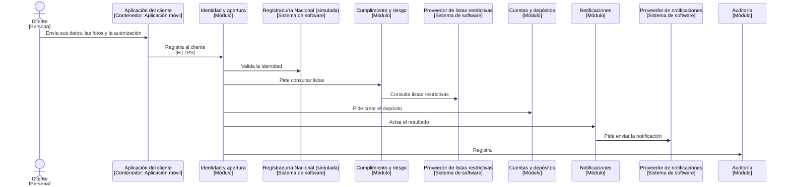
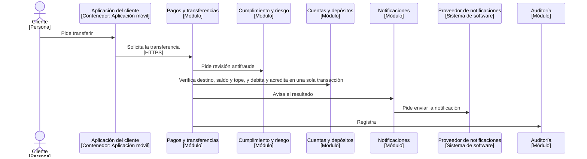
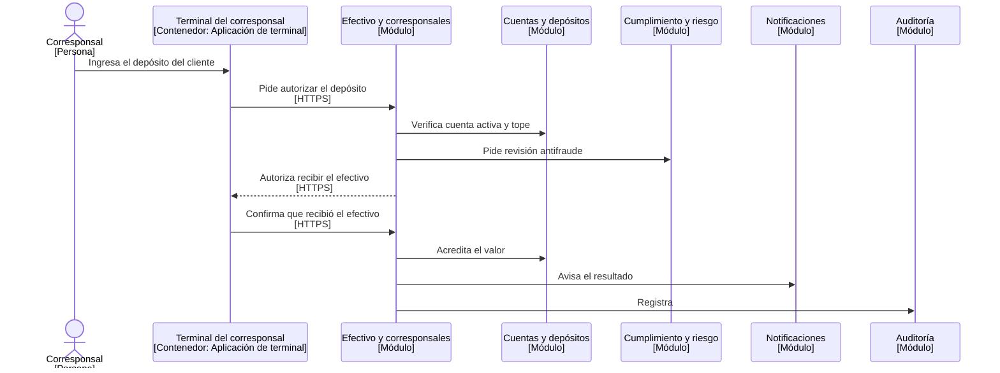

# Secuencias UML

Tres flujos de [casos de uso](../requisitos/casos-de-uso.md), dibujados como diagramas de secuencia UML. Se generan desde vistas dinámicas del mismo modelo C4, así que usan los mismos nombres de personas, aplicaciones, módulos y sistemas externos. Cada flecha entre módulos es una llamada a su puerta pública.

## Abrir un depósito (CU-01)

Registra al cliente, valida su identidad con la Registraduría (simulada), consulta las listas restrictivas, crea el depósito y notifica. Requisitos RF-01 a RF-06.

## Transferir entre cuentas Kuenta (CU-05)

Es una operación **interna**: el módulo Pagos le pide a Cuentas verificar destino, saldo y tope, y debitar y acreditar en **una sola transacción**. Si algo falla, la base de datos deshace todo y el saldo nunca queda a medias ([PA-02](../arquitectura-empresarial/principios.md#pa-02-el-dinero-siempre-cuadra)). Requisitos RF-08 y RF-12.

## Depositar efectivo en un corresponsal (CU-03)

El orden importa: Kuenta **autoriza antes** de que el corresponsal reciba el dinero y **acredita después** de que lo confirma. La flecha punteada es una respuesta. Requisitos RF-09 y RF-10.

## Qué no muestran

- Los caminos de fallo: la revisión manual de lo retenido, el rechazo por tope o los reintentos. Se detallan con el modelo de eventos y las sagas en el Módulo 6 (datos y consistencia).
- La transferencia por Bre-B, que es externa y por eso necesita reserva, confirmación y compensación. Se diseña en los Módulos 6 y 7.

:::note Por verificar
La exportación de vistas dinámicas a diagrama de secuencia de Mermaid está documentada por Structurizr ([Exportar a Mermaid](https://docs.structurizr.com/export/mermaid)); el resultado se revisa visualmente en el sitio.
:::
