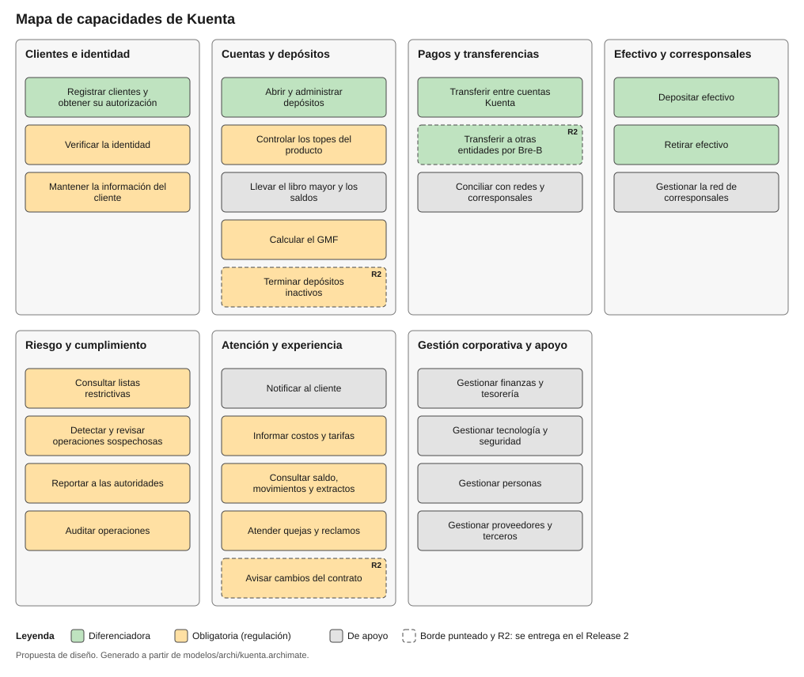
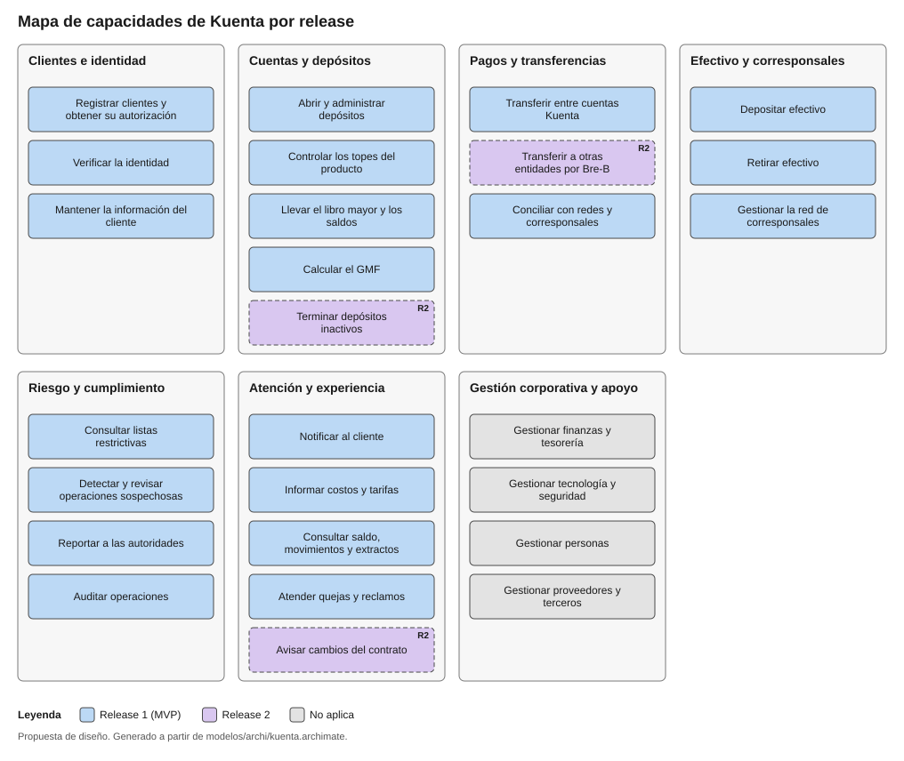

# Mapa de capacidades

Qué necesita saber hacer Kuenta para cumplir su propósito, sin decir todavía **cómo** se hace ni **con qué sistema**. Una capacidad combina personas, procesos, información y tecnología: por eso no es lo mismo que un proceso. Los procesos BPMN del [Módulo 1](../modulos/caso-de-negocio.md) muestran el recorrido; las capacidades muestran qué habilidades de la empresa hacen posible esos recorridos.

El mapa tiene **dos niveles**: siete grupos (dominios) y 27 capacidades. Se construyó a partir de lo ya definido: los ocho procesos, las siete épicas del [backlog](../agil/epicas-e-historias.md) y las obligaciones regulatorias.

## Vista por tipo

## Vista por release

## Tipos de capacidad

| Tipo | Qué significa |
|---|---|
| Diferenciadora | Es lo que hace distinta la propuesta de Kuenta: abrir sin ir a una oficina, mover efectivo por corresponsales y transferir al instante |
| Obligatoria | La exige la regulación; no hacerla bien no es una opción |
| De apoyo | Hace falta para operar, pero ni diferencia a Kuenta ni la exige directamente una norma |

La clasificación es una **propuesta de diseño**: depende de la estrategia de negocio, que aquí es ficticia.

## Dominios de negocio

| Dominio | Qué cubre |
|---|---|
| Clientes e identidad | Quién es el cliente y cómo se le verifica |
| Cuentas y depósitos | El producto, su saldo y sus límites |
| Pagos y transferencias | Mover dinero entre cuentas y hacia otras entidades |
| Efectivo y corresponsales | Entrada y salida de efectivo por la red de corresponsales |
| Riesgo y cumplimiento | Lo que exigen el SARLAFT y los reguladores |
| Atención y experiencia | Lo que el cliente ve, recibe y puede reclamar |
| Gestión corporativa y apoyo | Funciones comunes de la empresa; no se detallan en este ejercicio |

Estos dominios son de **negocio**. En el Módulo 5 se refinan como límites de la aplicación.

## Catálogo de capacidades

| Id | Capacidad | Dominio | Tipo | Release | Requisitos | Historias |
|---|---|---|---|---|---|---|
| CAP-01 | Registrar clientes y obtener su autorización | Clientes e identidad | Diferenciadora | 1 | RF-01, RF-02 | HU-01, HU-02 |
| CAP-02 | Verificar la identidad | Clientes e identidad | Obligatoria | 1 | RF-03, RF-05 | HU-03, HU-04 |
| CAP-03 | Mantener la información del cliente | Clientes e identidad | Obligatoria | 1 | RF-07 | HU-07 |
| CAP-04 | Abrir y administrar depósitos | Cuentas y depósitos | Diferenciadora | 1 | RF-06 | HU-05 |
| CAP-05 | Controlar los topes del producto | Cuentas y depósitos | Obligatoria | 1 | RF-08 | HU-08 |
| CAP-06 | Llevar el libro mayor y los saldos | Cuentas y depósitos | De apoyo | 1 | RNF-02 | Sin historia propia todavía |
| CAP-07 | Calcular el GMF | Cuentas y depósitos | Obligatoria | 1 | RF-19 | HU-13 |
| CAP-08 | Terminar depósitos inactivos | Cuentas y depósitos | Obligatoria | 2 | RF-14 | HU-23 |
| CAP-09 | Transferir entre cuentas Kuenta | Pagos y transferencias | Diferenciadora | 1 | RF-12 | HU-16 |
| CAP-10 | Transferir a otras entidades por Bre-B | Pagos y transferencias | Diferenciadora | 2 | RF-13 | HU-17 |
| CAP-11 | Conciliar con redes y corresponsales | Pagos y transferencias | De apoyo | 1 | RNF-02 | Sin historia propia todavía |
| CAP-12 | Depositar efectivo | Efectivo y corresponsales | Diferenciadora | 1 | RF-09, RF-10 | HU-14 |
| CAP-13 | Retirar efectivo | Efectivo y corresponsales | Diferenciadora | 1 | RF-11 | HU-15 |
| CAP-14 | Gestionar la red de corresponsales | Efectivo y corresponsales | De apoyo | 1 | CU-09 | Sin historia propia todavía |
| CAP-15 | Consultar listas restrictivas | Riesgo y cumplimiento | Obligatoria | 1 | RF-04 | HU-06 |
| CAP-16 | Detectar y revisar operaciones sospechosas | Riesgo y cumplimiento | Obligatoria | 1 | RF-15, RF-16 | HU-09, HU-10 |
| CAP-17 | Reportar a las autoridades | Riesgo y cumplimiento | Obligatoria | 1 | RF-17 | HU-11 |
| CAP-18 | Auditar operaciones | Riesgo y cumplimiento | Obligatoria | 1 | RF-18 | HU-12 |
| CAP-19 | Notificar al cliente | Atención y experiencia | De apoyo | 1 | RF-20 | HU-18 |
| CAP-20 | Informar costos y tarifas | Atención y experiencia | Obligatoria | 1 | RF-21 | HU-19 |
| CAP-21 | Consultar saldo, movimientos y extractos | Atención y experiencia | Obligatoria | 1 | RF-22 | HU-20 |
| CAP-22 | Atender quejas y reclamos | Atención y experiencia | Obligatoria | 1 | RF-23 | HU-21 |
| CAP-23 | Avisar cambios del contrato | Atención y experiencia | Obligatoria | 2 | RF-24 | HU-22 |
| CAP-24 | Gestionar finanzas y tesorería | Gestión corporativa y apoyo | De apoyo | No aplica | Sin detallar | Sin detallar |
| CAP-25 | Gestionar tecnología y seguridad | Gestión corporativa y apoyo | De apoyo | No aplica | Sin detallar | Sin detallar |
| CAP-26 | Gestionar personas | Gestión corporativa y apoyo | De apoyo | No aplica | Sin detallar | Sin detallar |
| CAP-27 | Gestionar proveedores y terceros | Gestión corporativa y apoyo | De apoyo | No aplica | Sin detallar | Sin detallar |

Los 24 requisitos funcionales del [catálogo](../requisitos/requisitos-funcionales.md) quedan cubiertos por al menos una capacidad. Las capacidades CAP-06, CAP-11 y CAP-14 nacen de atributos de calidad o de actores, no de un requisito funcional, y todavía no tienen historia propia en el backlog.

:::note Por verificar
- El criterio de nombrar las capacidades por **qué** hace el negocio y no por cómo ni quién lo hace viene de buenas prácticas generales; las fuentes consultadas no lo confirman y falta contrastarlo con la especificación oficial de ArchiMate.
- Falta comparar este mapa con el modelo de referencia de BIAN (*Banking Industry Architecture Network*): su documentación oficial exige inicio de sesión y solo se consultó un resumen público.
:::

## El modelo en Archi

El mapa vive en `modelos/archi/kuenta.archimate`, con las capacidades dentro de sus dominios, sus propiedades (tipo, release, requisitos e historias) y dos vistas. Las imágenes de esta página se generaron a partir del mismo modelo. Si se ajusta el diseño en Archi, conviene exportar de nuevo las imágenes a `diagramas/`.

:::note Fuentes
- Qué es un mapa de capacidades: [Visual Paradigm](https://guides.visual-paradigm.com/?p=3536) y [GEA-NZ](https://dns.govt.nz/standards-and-guidance/technology-and-architecture/government-enterprise-architecture/gea-nz-framework/business-capabilities)
- Cómo se modela en ArchiMate: [Unicom, Capability Map Viewpoint](https://support.unicomsi.com/manuals/systemarchitect/1149/Architecting_and_designing/ArchiMate3z1496301.html)
- Tres niveles de BIAN: [Wikipedia](https://en.wikipedia.org/wiki/Banking_Industry_Architecture_Network)
:::
