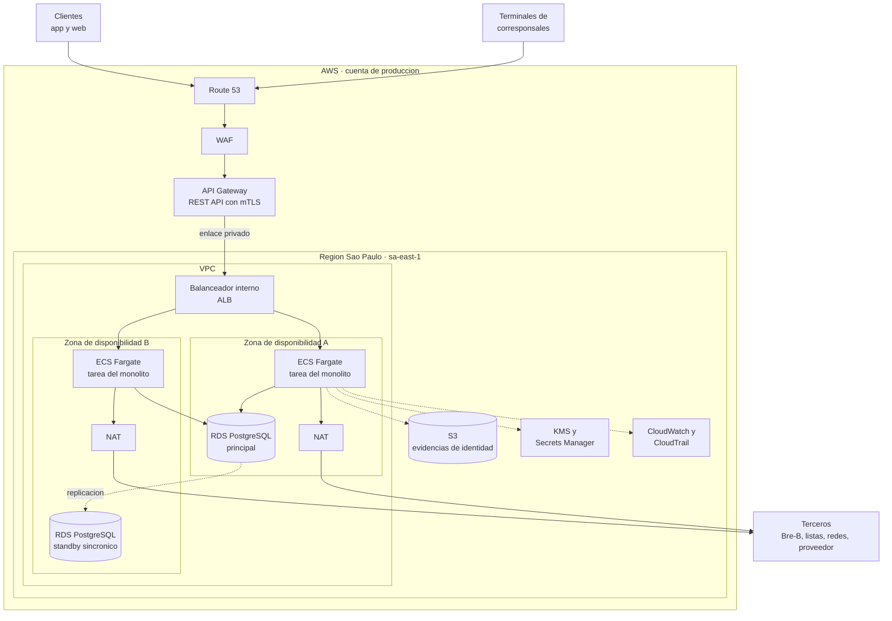

# Diagrama de despliegue

Cómo se ve Kuenta en AWS: **dónde corre cada pieza** y por dónde entra y sale el tráfico. Es la vista de despliegue de C4 del monolito modular definido en el [Módulo 5](../arquitectura-aplicacion/diagramas-c4.md).

## Cómo leerlo

- **Entrada única:** todo el tráfico de clientes y terminales pasa por WAF y API Gateway. Los terminales se identifican con certificado (mTLS) en una ruta aparte.
- **Dos zonas de disponibilidad:** el monolito corre en al menos dos tareas y la base de datos tiene un standby en la otra zona. Si cae una zona, la otra sigue.
- **Subredes:** el balanceador, la aplicación y la base de datos viven en subredes privadas sin dirección pública. Solo las puertas NAT tienen salida a internet, para llegar a los terceros.
- **Servicios de apoyo** (S3, KMS, Secrets Manager, CloudWatch, CloudTrail) son regionales y se acceden con *endpoints* privados de la VPC.
- Los terceros se muestran como un solo bloque; el detalle está en el [mapa de integraciones](../integracion-y-apis/mapa-de-integraciones.md).

Copia editable en draw.io: `modelos/despliegue/despliegue-aws.drawio`.
