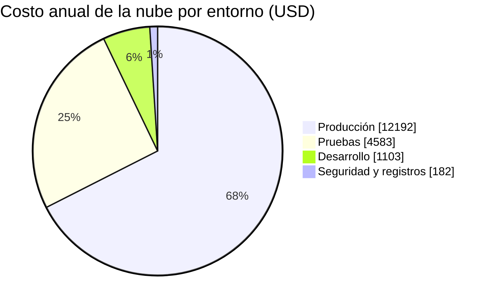

# Estimación anual

Decisiones A, B y D del Módulo 12. Todos los valores están en **dólares por año** y en la región São Paulo (`sa-east-1`) del [diagrama de despliegue](../arquitectura-en-aws/diagrama-de-despliegue.md). Los supuestos de volumen están en [Supuestos y fuentes](./supuestos-y-fuentes.md).

## Resumen

| Concepto | Total anual (USD) |
|---|---:|
| Producción | 12.192 |
| Pruebas | 4.583 |
| Desarrollo | 1.103 |
| Seguridad y registros | 182 |
| **Nube, sin soporte** | **18.060** |
| Soporte de AWS (Business Support+, propuesta) | 2.206 |
| **Total de nube con soporte** | **20.266** |

Faltan por confirmar, y por eso no están sumados: GuardDuty, Security Hub, la zona de Route 53, las copias entre regiones del plan de recuperación y la transferencia de datos hacia internet. Las líneas que no son de nube están en [Alcance más allá de la nube](./optimizacion-y-finops.md#alcance-más-allá-de-la-nube).

## Producción

| Concepto | Total anual (USD) | Precio de referencia |
|---|---:|---|
| Fargate ARM: 2 tareas de 1 vCPU y 2 GB, 24 h | 1.190 | 0,0557 por vCPU-hora y 0,00612 por GB-hora |
| RDS PostgreSQL db.m7g.large Multi-AZ | 3.872 | 0,442 por hora |
| RDS almacenamiento gp3 Multi-AZ, 100 GB | 524 | 0,437 por GB-mes |
| RDS copias de seguridad, 100 GB adicionales | 114 | 0,095 por GB-mes |
| ALB (1 + 2 LCU promedio) | 491 | 0,034 por hora y 0,011 por LCU-hora |
| NAT Gateway, 2 (una por zona) + 500 GB al mes | 2.187 | 0,093 por hora y 0,093 por GB |
| Endpoints de VPC de interfaz: 6 servicios en 2 zonas + 200 GB al mes | 1.624 | 0,0151 por hora y por GB (por confirmar) |
| API Gateway REST: 5 millones de solicitudes al mes | 255 | 4,25 por millón |
| WAF: 1 ACL, 10 reglas y 5 millones de solicitudes al mes | 216 | 5 por ACL, 1 por regla, 0,60 por millón |
| KMS: 10 llaves y 1 millón de solicitudes al mes | 156 | 1 por llave al mes; 0,000003 por solicitud |
| Secrets Manager: 20 secretos | 96 | 0,40 por secreto al mes |
| CloudWatch: 100 GB de logs al mes, retención 1 año y 50 alarmas | 1.185 | 0,675 por GB ingerido; 0,0408 por GB-mes; 0,135 por alarma |
| Inspector: 30 imágenes nuevas al mes en ECR | 40 | 0,11 por imagen |
| S3: 500 GB (evidencia, registros y copias) | 243 | 0,0405 por GB-mes |

**Subtotal de producción: 12.192 USD al año.**

## Pruebas

| Concepto | Total anual (USD) |
|---|---:|
| Fargate ARM: 1 tarea de 0,5 vCPU y 1 GB, 24 h | 298 |
| RDS db.m7g.large una zona | 1.936 |
| RDS almacenamiento gp3, 50 GB | 131 |
| ALB | 394 |
| NAT Gateway, 1 + 50 GB al mes | 870 |
| Endpoints de VPC: 6 servicios en 1 zona | 794 |
| Logs, KMS y secretos | 160 |

**Subtotal de pruebas: 4.583 USD al año.** Es una copia reducida de producción: una zona, una tarea y una sola salida a internet.

## Desarrollo

| Concepto | Total anual (USD) |
|---|---:|
| Fargate ARM: 0,25 vCPU y 0,5 GB, horario hábil | 45 |
| RDS db.t4g.medium una zona, horario hábil | 362 |
| RDS almacenamiento gp3, 20 GB | 53 |
| ALB, horario hábil | 119 |
| NAT Gateway, horario hábil | 246 |
| Endpoints de VPC, horario hábil | 239 |
| Logs, KMS y secretos | 40 |

**Subtotal de desarrollo: 1.103 USD al año.** Se enciende solo en horario hábil (10 horas, 22 días al mes) y se destruye fuera de él con la infraestructura como código.

## Seguridad y registros

| Concepto | Total anual (USD) |
|---|---:|
| S3: 300 GB de registros y evidencia | 146 |
| KMS: 3 llaves | 36 |

**Subtotal: 182 USD al año**, sin GuardDuty ni Security Hub.

## Qué pesa más en producción

| Rubro | Total anual (USD) | Parte de producción |
|---|---:|---:|
| RDS (instancia, almacenamiento y copias) | 4.510 | 37 % |
| Red privada (NAT y endpoints de VPC) | 3.811 | 31 % |
| Fargate | 1.190 | 10 % |
| CloudWatch | 1.185 | 10 % |

La red privada pesa casi lo mismo que la base de datos. Es el precio de no exponer nada a internet ([principio de red cerrada del Módulo 8](../arquitectura-en-aws/decisiones.md)).
