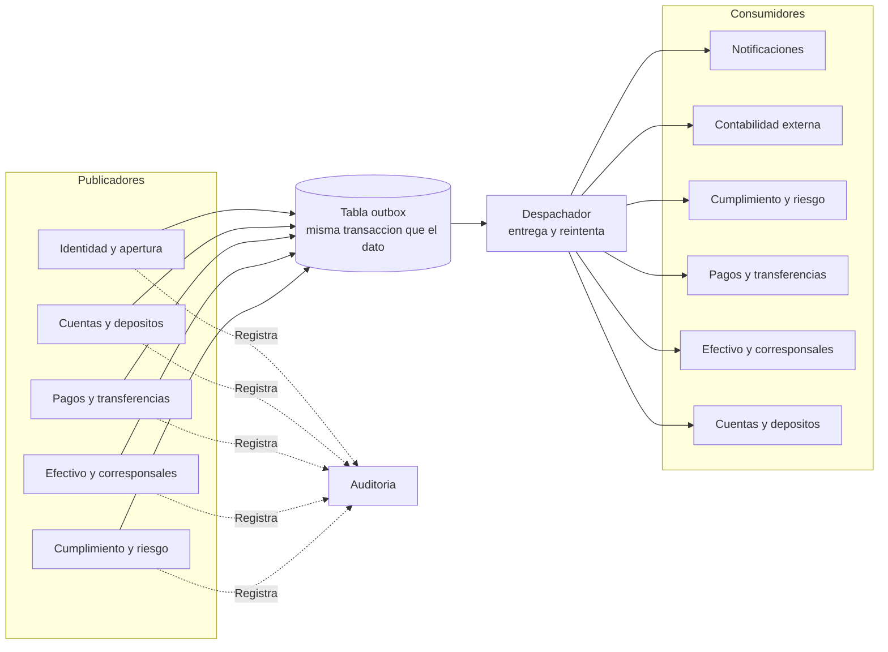

# Flujo de eventos

Decisión C del Módulo 6: **cómo se enteran los demás módulos de lo que pasó**.

Un **evento** es el aviso de un hecho que ya ocurrió («Depósito creado», «Transferencia completada»). Quien lo publica no sabe quién lo usará; así se evita que un módulo dependa de otro para lo accesorio.

## C1. Tres formas de avisar

| Forma | Cómo funciona | Riesgo |
|---|---|---|
| Llamada directa | Se llama a la puerta pública del otro módulo, dentro de la misma transacción | Acopla: si el otro falla, falla la operación |
| Evento en memoria | Se publica al terminar la transacción | Si la aplicación se cae justo en medio, el evento se pierde |
| **Evento con outbox** | El evento se guarda en la misma transacción que el dato y un proceso aparte lo publica después | Puede llegar repetido: el consumidor debe ser idempotente |

**Decisión: mezclar según lo que se juegue.**

- **Auditoría:** llamada directa en la misma transacción. Si no queda la huella, la operación no se hace.
- **Notificaciones, asientos para el sistema contable y reportes:** eventos con outbox. No deben bloquear la operación ni perderse.

El *transactional outbox* resuelve el problema de la doble escritura (guardar en la base y publicar en otro lado no es atómico). Se describe en las [guías de patrones de AWS](https://docs.aws.amazon.com/prescriptive-guidance/latest/cloud-design-patterns/transactional-outbox.html), que también advierten de las entregas duplicadas y del orden.

## C2. Catálogo de eventos de alto nivel

| Evento | Lo publica | Lo consumen |
|---|---|---|
| Cliente verificado o rechazado | Identidad y apertura | Notificaciones |
| Depósito creado | Cuentas y depósitos | Notificaciones, contabilidad |
| Movimiento registrado | Cuentas y depósitos | Contabilidad, Cumplimiento y riesgo |
| Reserva creada, confirmada o liberada | Cuentas y depósitos | Pagos y transferencias |
| Transferencia completada o fallida | Pagos y transferencias | Notificaciones |
| Efectivo autorizado, confirmado o vencido | Efectivo y corresponsales | Cuentas y depósitos, Notificaciones |
| Operación retenida, liberada o rechazada | Cumplimiento y riesgo | Pagos y transferencias, Efectivo y corresponsales, Notificaciones |
| Depósito terminado por inactividad | Cuentas y depósitos | Notificaciones, contabilidad |
| Reporte enviado a la autoridad | Cumplimiento y riesgo | (queda en Auditoría) |

«Contabilidad» es el sistema contable externo; recibe los asientos que entrega Cuentas.

## C3. Contenido mínimo de un evento

- Identificador único.
- Tipo y versión.
- Fecha.
- Identificador de correlación, para seguir una operación de punta a punta.
- Los datos justos para quien lo consume.
- **Nunca datos personales**: solo identificadores (decisión A).

## C4. Transporte

Dentro del monolito: la tabla outbox y un proceso que entrega a los consumidores internos. Un servicio de mensajería de AWS solo aparece si algún módulo pasa a servicio o si una integración externa lo pide; eso se decide en el Módulo 8. Es lo más simple que cumple (PA-06).

## Quién publica y quién consume

La línea punteada es la llamada directa a Auditoría dentro de la misma transacción; las continuas son eventos con outbox.

## Reglas para los consumidores

1. **Idempotentes:** procesar dos veces el mismo evento no duplica efectos. Se usa el identificador del evento.
2. **Tolerantes al orden:** no se asume que lleguen ordenados; si el orden importa, el evento trae un número de secuencia por entidad.
3. **Aislados:** si un consumidor falla, no frena a los demás; el despachador reintenta con esperas crecientes.
4. **Con consumo visible:** los eventos que no se pudieron entregar quedan en una cola de errores para revisión, y la métrica correspondiente se define en el Módulo 10.

## Consecuencia para el Módulo 5

Los diagramas del Módulo 5 dibujaban «Avisa» como llamada. Con esta decisión pasan a **«Publica evento»**; «Registra» (Auditoría) se mantiene como llamada directa. Ya está corregido en el modelo y en los diagramas.
