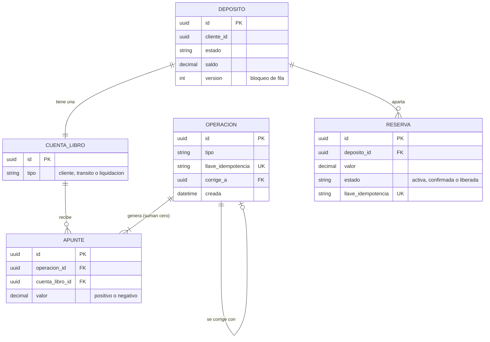
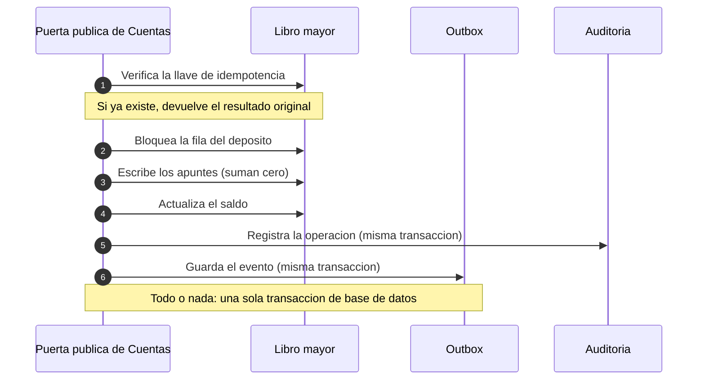

# Libro mayor

Decisión B del Módulo 6: **cómo se registra el dinero**. Es lo más importante del módulo porque de aquí depende el principio PA-02: «el dinero siempre cuadra».

Un **libro mayor** es el registro donde queda cada movimiento de dinero. Se escribe una vez y no se modifica: si hay un error, se corrige con un movimiento nuevo.

## B1. Partida doble ligera

Cada operación escribe varios **apuntes que suman cero**. Una transferencia de 50.000 pesos es −50.000 en la cuenta A y +50.000 en la cuenta B. El dinero que sale a Bre-B o a un corresponsal pasa por **cuentas internas de tránsito**; no desaparece de un lado y aparece en otro.

- **Ventaja:** «el dinero cuadra» se verifica con una suma. Si la suma de todos los apuntes no da cero, hay un error. También facilita conciliar con Bre-B y con las redes de corresponsales.
- **Costo:** más registros y una idea más para explicar. Se llama «ligera» porque no es contabilidad formal: la contabilidad sigue siendo del sistema contable externo, al que Cuentas le entrega los asientos.

| Operación | Apuntes (suman cero) |
|---|---|
| Transferencia entre cuentas de 50.000 | Depósito A −50.000 · Depósito B +50.000 |
| Transferencia Bre-B de 50.000 (al confirmar) | Depósito A −50.000 · Tránsito Bre-B +50.000 |
| Liquidación de lo enviado por Bre-B | Tránsito Bre-B −50.000 · Contrapartida de liquidación +50.000 |
| Depósito de efectivo de 100.000 (al confirmar) | Tránsito efectivo −100.000 · Depósito A +100.000 |

Los valores del GMF y de otras tarifas siguen la misma regla: son apuntes más en la misma operación.

## B2. Saldo

El saldo se guarda y se actualiza **en la misma transacción** que escribe los apuntes, bloqueando esa fila para que dos operaciones simultáneas no la pisen. Un proceso periódico **recalcula** el saldo desde los apuntes y avisa si no coincide. El **saldo disponible** es el saldo menos las reservas activas.

## B3. Correcciones

Un error se corrige con un **movimiento contrario** que lo anula, nunca con `UPDATE` ni `DELETE`. A la aplicación se le quitan esos permisos sobre las tablas del libro.

## B4. Idempotencia

Toda operación que mueve dinero lleva una **llave de idempotencia**: un identificador único. Si la misma petición llega dos veces por un reintento, la base de datos rechaza el duplicado y se devuelve el resultado original. Importa sobre todo con Bre-B y con los reintentos de los terminales.

## Reglas de representación

- Valores en **decimal exacto** (o entero en la unidad mínima), nunca punto flotante.
- Una sola moneda: COP.
- Los apuntes guardan solo identificadores, no datos personales (decisión A).

## Detalle del libro

## Escritura de una operación

## Verificaciones periódicas

| Verificación | Qué detecta |
|---|---|
| Suma de todos los apuntes = 0 | Una operación escrita a medias o con error |
| Saldo guardado = suma de apuntes de la cuenta | Un saldo que se desvió |
| Tránsito Bre-B y efectivo contra los extractos de Bre-B y de las redes | Operaciones enviadas que no se confirmaron, o confirmadas que no se registraron |

Los umbrales y la frecuencia de estas verificaciones se fijan en el Módulo 10.
