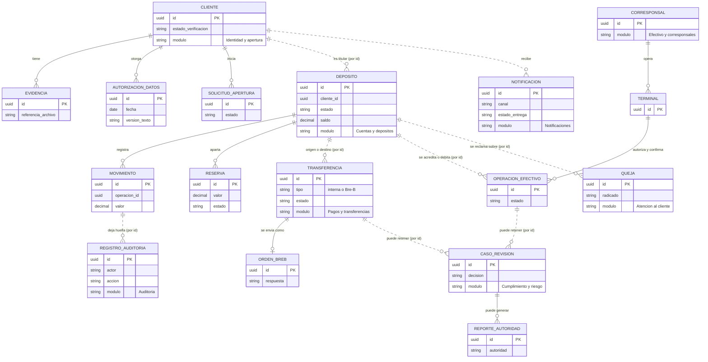

# Modelo de datos

Decisión A del Módulo 6: **quién es dueño de cada dato**. Parte de los [8 módulos](../arquitectura-aplicacion/estilo-y-limites.md) del Módulo 5 y del principio PA-05 («un solo dueño por cada dato»).

## La regla de fondo

Cada módulo tiene su propio esquema dentro de la misma base de datos. **Ningún módulo lee las tablas de otro**: si necesita un dato, lo pide por la puerta pública del dueño. Las referencias entre módulos se guardan solo como identificador (sin llave foránea entre esquemas), de modo que un módulo pueda mudarse a servicio sin romper tablas ajenas.

## Datos de cada módulo

| Módulo | Datos de los que es dueño |
|---|---|
| **Identidad y apertura** | Cliente (datos personales y estado de verificación), evidencias (referencia a la foto del documento y del rostro), autorización de tratamiento de datos (fecha y versión), solicitud de apertura y su estado |
| **Cuentas y depósitos** | Depósito, movimiento (nunca se modifica), reserva, parámetros (SMLMV y tope de 8 SMLMV), cálculo del GMF, asientos para contabilidad |
| **Pagos y transferencias** | Transferencia (entre cuentas y Bre-B, con su estado), orden Bre-B y su respuesta, partidas de conciliación con Bre-B |
| **Efectivo y corresponsales** | Corresponsal y terminal, operación de efectivo (autorizada, confirmada o vencida), conciliación con las redes |
| **Cumplimiento y riesgo** | Caso de revisión (retención y decisión del analista), resultado de consulta de listas, reglas antifraude, reportes a la UIAF y a la Superintendencia Financiera |
| **Atención al cliente** | Catálogo de tarifas, queja o reclamo (con radicado), extractos, avisos de cambios de contrato |
| **Notificaciones** | Notificación (canal, plantilla, estado de entrega) y preferencias de canal |
| **Auditoría** | Registro de cada operación (quién, qué, cuándo, resultado); solo se agrega |

## Tres decisiones adicionales

1. **Archivos de identidad fuera de la base de datos.** La base guarda solo la referencia a las fotos; los archivos viven en almacenamiento de objetos. Así la base no engorda con binarios y se pueden proteger y retener de forma distinta. El servicio concreto se elige en el Módulo 8.
2. **Datos personales separados del dinero.** Depósito, movimiento y auditoría guardan solo el identificador del cliente, nunca sus datos personales. Así el libro mayor y la auditoría se conservan todo el plazo legal sin chocar con las obligaciones de la Ley 1581 sobre datos personales.
3. **Consultas entre módulos por la puerta pública.** Por ejemplo, Atención le pide a Cuentas los movimientos. Las copias de lectura alimentadas por eventos se permiten solo si hay una razón medible (reportes pesados) y siempre con un solo dueño.

## Diagrama entidad-relación general

Las líneas punteadas son referencias por identificador entre módulos; las continuas, relaciones dentro del mismo módulo. Cada entidad lleva, entre paréntesis, el módulo dueño.

:::note Alcance
Es un modelo de **alto nivel**: muestra qué entidad es de quién y cómo se conectan, no cada columna. El diseño físico (tipos, índices, particiones) se hace al construir, dentro de cada esquema.
:::

Las copias editables están en `modelos/datos/` (ver [README](https://github.com/maomauro/fintech-kuenta/tree/main/modelos/datos)). El detalle del dinero está en el [libro mayor](./libro-mayor.md).
