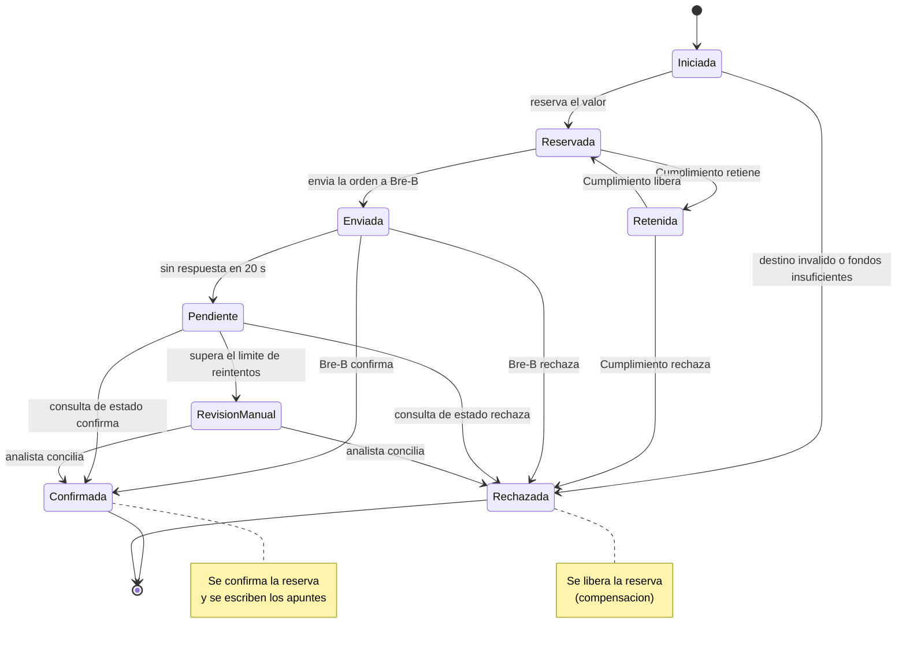
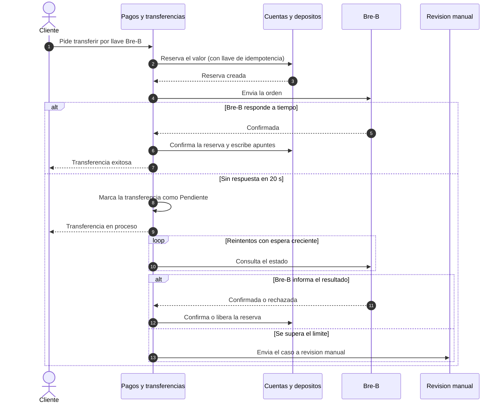
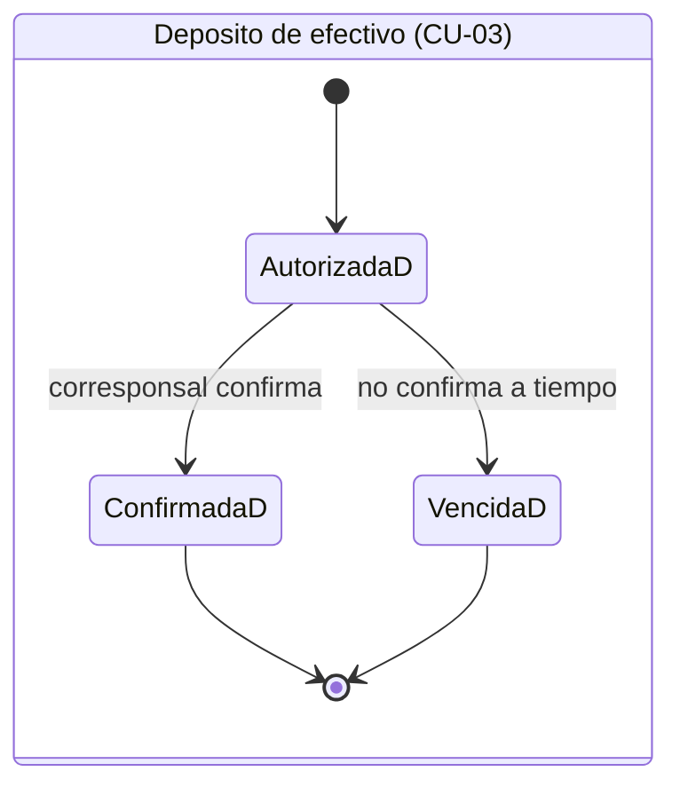
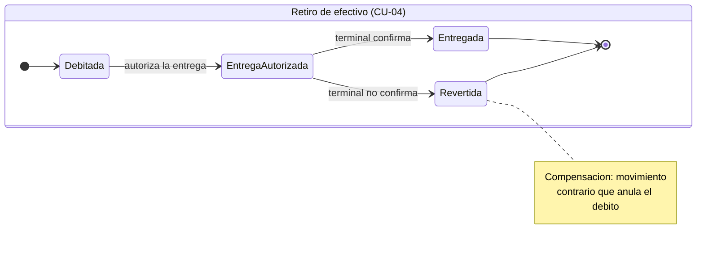

# Sagas y estados

Decisión D del Módulo 6: **qué hacer cuando un proceso no cabe en una sola transacción**.

Una **saga** es un proceso de varios pasos donde cada paso es una transacción local y, si uno falla, se ejecuta una **compensación** que deshace los anteriores. En Kuenta se necesita solo cuando interviene un sistema externo, porque dentro del monolito todo cabe en una transacción de base de datos.

## D1. Qué flujos son saga

| Flujo | ¿Saga? | Por qué |
|---|---|---|
| Transferencia entre cuentas (CU-05) | No | Una sola transacción de base de datos |
| Transferencia por Bre-B (CU-06) | **Sí** | Se consulta el destino, se reserva el valor, se envía la orden y se confirma el débito o se libera la reserva |
| Depositar efectivo (CU-03) | **Sí** | Se autoriza antes, el corresponsal recibe el dinero, confirma y entonces se acredita. Si nunca confirma, la autorización vence |
| Retirar efectivo (CU-04) | **Sí** | Se debita primero y luego se autoriza la entrega. Si el terminal no confirma, la compensación es un movimiento contrario que anula el débito |
| Apertura (CU-01) | No | No mueve dinero: se modela como estados (en validación, en revisión manual, aprobada, rechazada), sin compensaciones |

## D2. Orquestada, dentro del módulo dueño

Hay dos variantes: **coreografiada** (cada módulo reacciona a eventos) y **orquestada** (un coordinador dirige los pasos). Se detallan en las guías de AWS: [coreografía](https://docs.aws.amazon.com/prescriptive-guidance/latest/cloud-design-patterns/saga-choreography.html) y [orquestación](https://docs.aws.amazon.com/prescriptive-guidance/latest/cloud-design-patterns/saga-orchestration.html).

**Decisión:** orquestada, dentro del módulo dueño del flujo: **Pagos y transferencias** para Bre-B y **Efectivo y corresponsales** para el efectivo. No es un servicio aparte: es una **máquina de estados** guardada en el esquema del propio módulo. Estos flujos tienen esperas, reintentos y estados pendientes; con un dueño claro es más fácil seguirlos y auditarlos. La coreografía complica el seguimiento cuando los pasos crecen.

## D3. Transferencia por Bre-B

Bre-B exige respuesta en un máximo de 20 segundos. Si no llega, la transferencia pasa a *pendiente* y **nunca se libera la reserva sin saber el resultado**: se consulta el estado y se concilia. Cómo se consulta exactamente se confirma en el Módulo 7, porque el documento técnico del Banco de la República no lo detalla (ver pendientes en la [nota del módulo](../modulos/datos-y-consistencia.md)).

### Secuencia con respuesta pendiente

## D4. Efectivo

El tiempo máximo de la autorización es un **parámetro**, sin valor fijo por ahora.

| Flujo | Qué se hace al confirmar | Qué se hace si no confirma |
|---|---|---|
| Depósito | Se acredita el valor al depósito | La autorización vence y no se escribe ningún apunte |
| Retiro | La entrega queda registrada | Se escribe un movimiento contrario que anula el débito |

## D5. Reintentos y casos que no se resuelven solos

- Cada paso lleva la **llave de idempotencia** de la [decisión B](./libro-mayor.md), así que repetirlo no duplica efectos.
- Los reintentos esperan cada vez más.
- Si un caso sigue *pendiente* pasado un límite parametrizable, pasa a **revisión manual** en la consola de back office.

## D6. Aislamiento

Las sagas no dan aislamiento: mientras un proceso está a medias, otro podría ver el saldo antes de que termine. La defensa es la **Reserva**, que aparta el valor mientras se espera la confirmación. Se llama *bloqueo semántico*.

## Parámetros que se dejan sin valor a propósito

| Parámetro | Se fija en |
|---|---|
| Tiempo de vencimiento de las autorizaciones de efectivo | Módulo 10 |
| Número de reintentos y espera entre ellos | Módulo 10 |
| Límite antes de pasar a revisión manual | Módulo 10 |
| Forma de consultar el estado en Bre-B | Módulo 7 |
