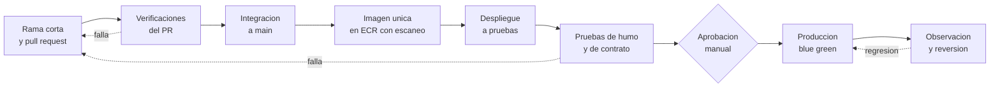

# Flujo de despliegue

Decisión A del Módulo 11: **cómo llega un cambio desde el teclado hasta producción**.

## A1. Principios

- **Ramas cortas y `main` siempre desplegable** (*trunk-based*). Cada cambio entra por un pull request con revisión obligatoria.
- **Se construye una sola vez.** La misma imagen del contenedor, identificada por su huella (*digest*), se promueve de un entorno al siguiente; nunca se reconstruye para producción.
- **Cuentas separadas por entorno** ([Módulo 8](../arquitectura-en-aws/decisiones.md)).
- **Quien escribe el cambio no aprueba su propio despliegue a producción** ([Módulo 9](../seguridad-y-cumplimiento/controles.md): separación de funciones).

## A2. Diagrama

Copia editable en draw.io: `modelos/entrega/flujo-de-despliegue.drawio`.

## A3. Entornos

| Entorno | Para qué | Cuenta de AWS | Datos | Cómo se despliega |
|---|---|---|---|---|
| Desarrollo | Probar integración temprana y ramas | Desarrollo | Sintéticos | Automático desde el PR |
| Pruebas | Validar la versión que irá a producción, con la misma forma que producción | Pruebas | Sintéticos | Automático al integrar a `main` |
| Producción | Clientes reales | Producción | Reales | Con aprobación manual |

**Los datos reales nunca se copian a desarrollo ni a pruebas** (Ley 1581 de 2012 y [Módulo 9](../seguridad-y-cumplimiento/controles.md)).

## A4. Aprobación

- Se usan *entornos* de GitHub con revisores obligatorios y la opción de impedir la autoaprobación ([doc](https://docs.github.com/en/actions/how-tos/deploy/configure-and-manage-deployments/manage-environments)). En repositorios públicos están disponibles en todos los planes; en privados requieren un plan de pago.
- Las ramas que pueden desplegar a cada entorno están restringidas.
