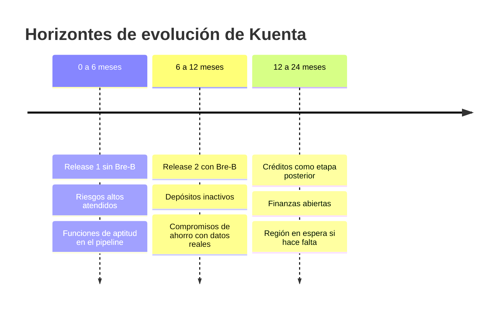

# Plan de evolución

Decisiones D y E del Módulo 14. Es una hoja de ruta de **intención**, no un compromiso de fechas: cada paso se activa por un disparador.

## Horizontes

| Horizonte | Objetivo | Disparador para pasar al siguiente |
|---|---|---|
| 0 a 6 meses | Release 1 en producción con las funciones de aptitud activas y los [riesgos altos](../decisiones-y-trade-offs/matriz-de-riesgos.md) atendidos | Release 1 estable y los riesgos altos cerrados o aceptados por ADR |
| 6 a 12 meses | Release 2 con Bre-B y depósitos inactivos; revisar el costo con 3 meses de datos y comprar compromisos de ahorro | Bre-B operando dentro de su SLO |
| 12 a 24 meses | Evaluar créditos, finanzas abiertas y región en espera | Decisión de negocio y verificación normativa |

## Evoluciones posibles

| Evolución | Qué la dispara | Qué cambia en la arquitectura | Por verificar |
|---|---|---|---|
| Créditos | Decisión de negocio | Nuevo dominio con su módulo, nuevos datos y reportes | La SEDPE no puede otorgar créditos; hay que verificar qué figura legal lo permite |
| Finanzas abiertas | Obligatoriedad y fecha de entrada | Nuevas APIs expuestas y gestión de consentimientos | Desde cuándo son obligatorias |
| Región en espera | Un regulador o un incidente exige menos de 4 horas de RTO ([ADR-007](../adr/adr-007-recuperacion-regional.md)) | Segunda región con réplica de datos | Costo, con el método del Módulo 12 |
| Extracción de módulos | Un umbral de [extracción](./extraccion-de-modulos.md) | Servicio nuevo y canal de mensajes | Señal y métrica |
| Nueva región o jurisdicción | Cambio de criterio de la SIC sobre Brasil ([R-02](../decisiones-y-trade-offs/matriz-de-riesgos.md)) | Despliegue en otra región | Servicios disponibles |

## Cadencia de actualización

| Componente | Regla |
|---|---|
| Java | Seguir las versiones con soporte largo (LTS). La próxima está prevista para septiembre de 2027 según [Oracle](https://oracle.com/java/technologies/java-se-support-roadmap.html), sujeta a cambio. Migrar con ADR y antes de que termine el soporte Premier |
| Spring Boot y Spring Modulith | Actualizar versiones menores cada trimestre. Una versión mayor se decide con ADR |
| Dependencias | Revisión automática con el análisis de composición del pipeline; corregir vulnerabilidades según su severidad |
| OpenTofu y proveedores | Actualizar cada trimestre, con `plan` en pruebas antes de producción |
| Regulación | Revisar cada trimestre y registrar cambios en la [matriz de cumplimiento](../seguridad-y-cumplimiento/matriz-de-cumplimiento.md) |

## Cómo se actualiza este plan

El plan se revisa cada año y cuando cambia un disparador. Un cambio de rumbo se registra como ADR nuevo.
