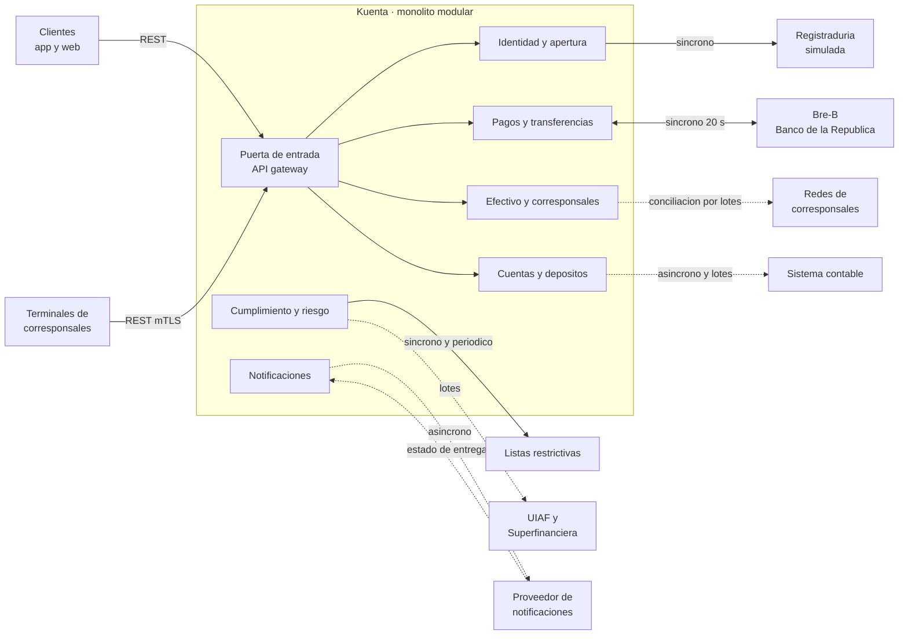

# Mapa de integraciones

Decisión A del Módulo 7: **con quién habla Kuenta, quién habla y de qué manera**.

## A1. Reglas

- **Un adaptador por integración**, dentro del módulo dueño. El adaptador traduce entre el idioma del tercero y el de Kuenta (capa anticorrupción); nada del formato externo entra al resto del código.
- **Un solo módulo habla con cada tercero.** Los demás piden al módulo dueño por su puerta pública.
- **Síncrono** si el cliente espera la respuesta; **asíncrono** (por outbox, ver [eventos](../datos-y-consistencia/eventos.md)) si no bloquea; **por lotes** para conciliaciones y reportes.
- Las entradas de terceros usan **rutas y credenciales distintas** de las de la API de clientes, aunque sea el mismo monolito.

## A2. Diagrama

Línea continua: el cliente o el flujo espera. Línea punteada: asíncrono o por lotes.

## A3. Tabla

| Integración | Módulo dueño | Forma | Etapa |
|---|---|---|---|
| Bre-B (enviar y recibir) | Pagos y transferencias | Síncrono, 20 s | Release 2 |
| Registraduría (simulada) | Identidad y apertura | Síncrono al abrir | Release 1 |
| Listas restrictivas | Cumplimiento y riesgo | Síncrono al abrir y revisión periódica | Release 1 |
| UIAF y Superfinanciera | Cumplimiento y riesgo | Lotes | Release 1 |
| Redes de corresponsales | Efectivo y corresponsales | Los terminales llaman a Kuenta, más conciliación por lotes | Release 1 |
| Proveedor de notificaciones | Notificaciones | Asíncrono y retorno del estado de entrega | Release 1 |
| Sistema contable | Cuentas y depósitos | Asíncrono y lotes | Release 1 |
| Finanzas abiertas | Por definir | Etapa posterior (Decreto 368 de 2026) | Posterior |

El canal y el formato de los reportes a UIAF y Superfinanciera **no se han investigado**: quedan como pendiente.

## A4. Corrección al Módulo 5

La conciliación con las redes de corresponsales estaba dibujada desde Pagos. El Módulo 6 se la asignó a Efectivo, y el diagrama de contenedores y componentes y `kuenta.dsl` ya muestran **Efectivo → Redes**.
