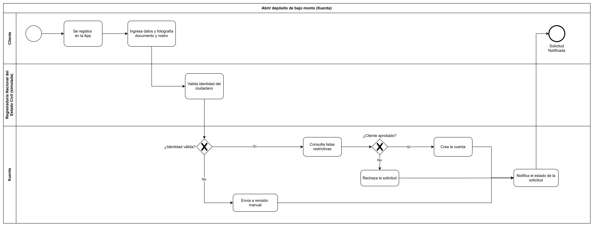
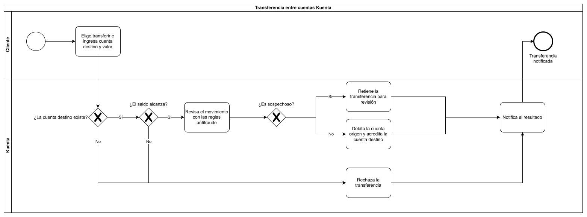
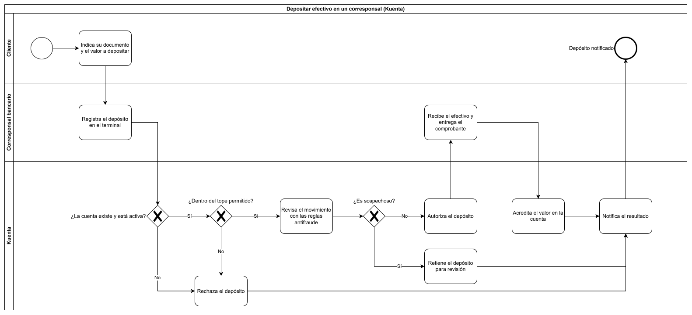
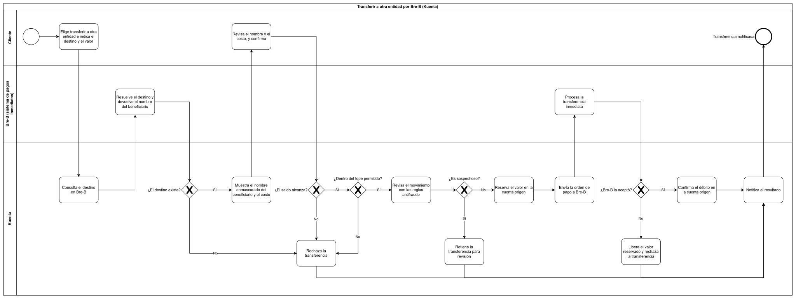

# Módulo 1 · Caso de negocio, interesados y alcance

:::note Actualizado en el Módulo 2
Al verificar la regulación se ajustaron tres definiciones de este módulo: Kuenta es una **SEDPE** (Sociedad Especializada en Depósitos y Pagos Electrónicos), su producto se llama **depósito de bajo monto** en lugar de "cuenta de ahorros", y los **créditos** pasan a una etapa posterior porque una SEDPE no puede otorgarlos. Además, las **transferencias a otras entidades por Bre-B** entran en la primera versión. Los motivos están en las notas del Módulo 2.
:::

**Entregable:** documento de contexto y objetivos, con los procesos clave modelados en BPMN.

Antes de elegir tecnologías hay que responder tres preguntas: qué problema resuelve Kuenta, para quién y hasta dónde llega la primera versión. Las decisiones de arquitectura de los módulos siguientes parten de estas respuestas.

## Caso de negocio

### El problema

Muchas personas en Colombia usan poco los servicios financieros formales. Los obstáculos habituales son los trámites presenciales, la documentación exigida, los costos y la desconfianza. Por eso el efectivo sigue siendo su opción principal, que es insegura y no ayuda a ahorrar.

:::note
Este texto es cualitativo. Las cifras de inclusión financiera se incorporarán más adelante, con sus fuentes oficiales.
:::

### Propuesta de valor

Kuenta ofrece un **depósito de bajo monto digital** (una cuenta de ahorro y pagos con tope regulado) que se abre desde el celular en pocos minutos, con verificación de identidad en línea, sin visitar una oficina y con reglas claras. Otros productos se suman después sobre la misma base; los créditos requieren otra figura legal o un aliado.

### Objetivos de la primera versión

| Tipo | Objetivo |
|---|---|
| Negocio | Que una persona abra su cuenta y ahorre sin ir a una oficina |
| Producto | Abrir una cuenta de forma totalmente digital y mover dinero con seguridad |
| Arquitectura | Una base que permita sumar productos (incluidos los créditos, en una etapa posterior) sin rehacer lo existente y que cumpla la regulación colombiana |

Las metas numéricas (usuarios, saldos, tiempos) se definirán con datos verificados.

### Público objetivo

**Personas naturales con poco acceso bancario.** Este público condiciona el diseño: la apertura no exige monto mínimo y el efectivo debe tener un canal de entrada y salida (los corresponsales bancarios).

## Interesados

| Grupo | Qué espera de Kuenta |
|---|---|
| Clientes | Abrir la cuenta con facilidad, tener su dinero seguro y enterarse de cada movimiento |
| Reguladores | Cumplimiento de la normativa, trazabilidad y reportes |
| Inversionistas | Un negocio viable que crezca de forma controlada |
| Equipo interno | Un sistema que se pueda mantener, probar y evolucionar |
| Aliados e integraciones | Interfaces claras y estables: la Registraduría (simulada), los corresponsales bancarios y otros terceros |

## Alcance de la primera versión

| Dentro | Fuera |
|---|---|
| Registro y verificación de identidad (KYC) | Créditos (una SEDPE no puede otorgarlos) |
| Depósito de bajo monto digital, sin monto mínimo de apertura | Pagos de servicios y recargas |
| Depósitos y retiros, incluido el efectivo en corresponsales bancarios | Tarjeta física |
| Transferencias entre cuentas Kuenta y a otras entidades por Bre-B | Cobros a comercios |
| Consulta de saldo y movimientos | Inversiones |
| Notificaciones y atención básica | Operación fuera de Colombia |
| Antifraude básico y reportes mínimos | |

La regulación de lo que está dentro se verificó en el Módulo 2. Una consecuencia directa es el **tope del depósito de bajo monto**: el saldo y los débitos mensuales no pueden superar 8 SMLMV (salarios mínimos legales mensuales vigentes), hoy $14.007.240.

## Procesos clave en BPMN

Se modelan cuatro procesos con **BPMN** (*Business Process Model and Notation*). Cada uno parte de una acción del cliente y termina siempre notificándole el resultado.

**Convenciones del modelado:**

- Las tareas se nombran con un verbo y un objeto ("Crea la cuenta").
- Todo camino termina en un evento de fin.
- El cliente siempre queda notificado del resultado, aunque la solicitud se rechace o quede en revisión.
- Los caminos excluyentes pueden converger en una misma tarea de notificación.

Los archivos editables están en `modelos/bpmn/` (draw.io) y las imágenes en `diagramas/`.

### 1. Abrir depósito de bajo monto

El cliente se registra y envía los datos y la fotografía de su documento y de su rostro. La **Registraduría Nacional del Estado Civil (simulada)** valida la identidad. Kuenta decide en dos compuertas:

- **¿Identidad válida?** Si no lo es, la solicitud pasa a revisión manual.
- **¿Cliente aprobado?** Tras consultar las listas restrictivas, la cuenta se crea o la solicitud se rechaza.

Los tres resultados (cuenta creada, rechazo o revisión manual) convergen en una sola notificación. La norma permite una **debida diligencia simplificada** para este producto: la información restante del cliente se completa después de la apertura, en un proceso aparte que se define como requisito en el Módulo 2.

### 2. Transferencia entre cuentas

El cliente elige transferir e indica la cuenta destino y el valor. Kuenta aplica cuatro decisiones en orden:

- **¿La cuenta destino existe?** Si no, rechaza la transferencia.
- **¿El saldo alcanza?** Si no, la rechaza.
- **¿Dentro del tope permitido?** Si el movimiento haría superar el tope de 8 SMLMV, la rechaza.
- **¿Es sospechoso?** Tras revisar el movimiento con las reglas antifraude, retiene la transferencia para revisión o debita y acredita.

### 3. Depositar efectivo en un corresponsal

El cliente entrega su documento y el valor en un corresponsal bancario, que registra el depósito en el terminal. Kuenta verifica que la cuenta exista y esté activa, comprueba que el depósito no supere el tope permitido y revisa el movimiento con las reglas antifraude. Solo cuando **autoriza** el depósito, el corresponsal recibe el efectivo y entrega el comprobante, y después Kuenta acredita el valor. Así, el corresponsal nunca se queda con dinero de un depósito que no se va a acreditar.

### 4. Transferir a otra entidad por Bre-B

Este proceso se agregó en el Módulo 2, cuando Bre-B entró en la primera versión. El cliente indica el destino y el valor, y Kuenta consulta el destino en **Bre-B**, que devuelve el nombre del beneficiario. Antes de continuar, Kuenta muestra ese nombre **enmascarado** junto con el **costo** de la operación, y el cliente confirma. Después aplica cuatro controles: que el destino exista, que el saldo alcance, que el movimiento esté dentro del tope y que no sea sospechoso. Si los pasa, **reserva** el valor, envía la orden de pago a Bre-B y, según la respuesta, confirma el débito o libera lo reservado. Los rechazos y las retenciones convergen en una sola notificación.

## Decisiones de este módulo

| Decisión | Resultado | Motivo |
|---|---|---|
| Público objetivo | Personas naturales con poco acceso bancario | Es donde el problema es más claro y donde la propuesta de valor se nota |
| Producto ancla | Depósito de bajo monto digital (ahorro y pagos) | Es la base sobre la que se agregan nuevos productos |
| Monto mínimo de apertura | Ninguno | Coherente con el público; el depósito es un proceso aparte |
| Verificación de identidad | Registraduría Nacional del Estado Civil, simulada | Realismo colombiano sin depender de un convenio real; se trata como sistema externo |
| Corresponsales bancarios | Incluidos como aliados | Permiten depositar y retirar efectivo, clave para este público |
| Figura legal | SEDPE | Es la figura que permite captar depósitos de bajo monto y ofrecer pagos electrónicos; no puede otorgar créditos |
| Nombre del producto | Depósito de bajo monto | Es el término legal; el nombre comercial se valida con un abogado antes de publicarlo |
| Transferencias a otras entidades | Dentro de la primera versión, por Bre-B | Un usuario que no puede enviar dinero a otros bancos tiene un producto muy limitado |
| Cuándo se notifica | Siempre, con cualquier resultado | El cliente nunca debe quedarse sin saber qué pasó con su solicitud |

## Estado

- [x] Caso de negocio, público objetivo e interesados
- [x] Alcance de la primera versión
- [x] BPMN: abrir depósito de bajo monto
- [x] BPMN: transferencia entre cuentas
- [x] BPMN: depositar efectivo en un corresponsal
- [x] BPMN: transferir a otra entidad por Bre-B (agregado en el Módulo 2)
- [x] Glosario ampliado (al final de esta página)

## Glosario

Términos nuevos de este módulo. Los demás están en el glosario del [Módulo 0](./entorno-y-herramientas.md#glosario).

| Sigla o término | Significado |
|---|---|
| Antifraude | Reglas y controles que detectan movimientos sospechosos antes de completarlos |
| Bre-B | Sistema de pagos inmediatos de Colombia: permite transferencias entre entidades al instante |
| Carril (*lane*) | Franja de un diagrama BPMN que agrupa las tareas de un mismo participante (cliente, Kuenta, corresponsal) |
| Compuerta (*gateway*) | Rombo de BPMN donde el proceso se bifurca según una decisión; la exclusiva (con una X) permite un solo camino |
| Corresponsal bancario | Comercio o punto autorizado que atiende operaciones de una entidad financiera, como depositar o retirar efectivo |
| Debida diligencia simplificada | Versión reducida del conocimiento del cliente que la norma permite para productos de bajo riesgo |
| Depósito de bajo monto | Producto de depósito electrónico para personas naturales, con tope de saldo y de débitos mensuales de 8 SMLMV |
| Evento | Círculo de BPMN que marca el inicio (borde fino) o el fin (borde grueso) de un proceso |
| Interesado (*stakeholder*) | Persona o grupo al que le afecta el sistema o que influye en él |
| KYC | *Know Your Customer*: "conozca a su cliente"; verificación de la identidad de quien abre una cuenta |
| Registraduría Nacional del Estado Civil | Entidad colombiana que administra el registro civil y la identificación de las personas; en Kuenta se simula como sistema externo de validación de identidad |
| SEDPE | Sociedad Especializada en Depósitos y Pagos Electrónicos: figura legal de Kuenta; puede captar depósitos de bajo monto y ofrecer pagos, pero no otorgar créditos |
| SMLMV | Salario Mínimo Legal Mensual Vigente: unidad con la que la norma fija el tope del depósito de bajo monto |
