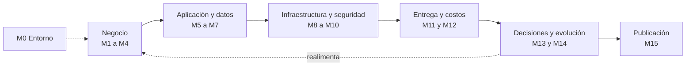

# Panorama de los módulos

Vista consolidada de los 16 módulos del curso: qué responde cada uno, qué entrega, qué se decidió y en qué estado está. Cada nombre enlaza a la nota completa del módulo, con sus decisiones, estado y glosario. La fuente de verdad del contexto es `00-contexto/00-contexto-y-decisiones.md`.

## Los 16 módulos

| # | Módulo | Pregunta que responde | Entregable | Decisiones clave | Estado |
|---|---|---|---|---|---|
| 0 | [Entorno y herramientas](entorno-y-herramientas.md) | ¿Con qué trabajo y dónde vive el proyecto? | Repositorio, sitio base y modelo vacío en Archi | Repositorio público, Docker para todo, Conventional Commits, una rama por módulo, Docusaurus en `sitio/` | Cerrado |
| 1 | [Caso de negocio, interesados y alcance](caso-de-negocio.md) | ¿Qué problema resuelve Kuenta y para quién? | Documento de contexto y procesos en BPMN | SEDPE, depósito de bajo monto, personas con poco acceso bancario, corresponsales, Bre-B desde la primera versión | Cerrado |
| 2 | [Requisitos, restricciones y regulación](requisitos.md) | ¿Qué debe cumplir el sistema? | Catálogo de requisitos y atributos de calidad priorizados | Prioridad: seguridad, integridad, disponibilidad, cumplimiento, rendimiento; 50.000 clientes y 50 TPS de pico (hipótesis) | Cerrado |
| 3 | [Metodología ágil](metodologia-agil.md) | ¿Cómo se organiza el trabajo? | Backlog inicial priorizado y plan de releases | Scrum, Product Goal único, historias con Dado/Cuando/Entonces, Release 1 sin Bre-B y Release 2 con Bre-B | Cerrado |
| 4 | [Arquitectura empresarial ligera](arquitectura-empresarial.md) | ¿Qué capacidades tiene el negocio? | Mapa de capacidades y principios en Archi | Dos niveles (dominios y capacidades), siete dominios, ocho principios en formato TOGAF | Cerrado |
| 5 | [Arquitectura de aplicación](arquitectura-de-aplicacion.md) | ¿Cómo se estructura el software? | Diagramas C4 y UML | Monolito modular con 8 módulos; diagramas Mermaid exportados desde Structurizr | Cerrado |
| 6 | [Datos y consistencia](datos-y-consistencia.md) | ¿Cómo se guarda el dinero y se propagan los cambios? | Modelo de datos y flujo de eventos | Esquema por módulo, libro mayor de partida doble, outbox y sagas para Bre-B y efectivo | Cerrado |
| 7 | [Integración y APIs](integracion-y-apis.md) | ¿Cómo se conecta con terceros? | Contratos de ejemplo y mapa de integraciones | Un adaptador por integración, REST con OpenAPI 3.1, `/v1`, RFC 9457, idempotencia, API Gateway administrado | Cerrado |
| 8 | [Arquitectura en AWS](arquitectura-en-aws.md) | ¿Dónde y sobre qué corre? | Diagrama de despliegue y tabla de servicios | Región São Paulo, tres cuentas, Fargate, RDS Multi-AZ, red privada | Cerrado |
| 9 | [Seguridad y cumplimiento](seguridad-y-cumplimiento.md) | ¿Cómo se protege y se demuestra el cumplimiento? | Modelo de amenazas y controles | STRIDE y OWASP API Top 10, 16 amenazas, identidad, datos y detección y respuesta | Cerrado |
| 10 | [Resiliencia y operación](resiliencia-y-operacion.md) | ¿Qué pasa cuando algo falla? | Plan de recuperación y objetivos de nivel de servicio | 7 SLO, tres escenarios de recuperación, parámetros de resiliencia y observabilidad | Cerrado |
| 11 | [Entrega: CI/CD e IaC](entrega-ci-cd-e-iac.md) | ¿Cómo llega un cambio a producción? | Diseño del flujo de despliegue | Trunk-based, una imagen promovida, OIDC, blue/green de ECS, OpenTofu, cinco métricas DORA | Cerrado |
| 12 | [Costos (FinOps)](costos-finops.md) | ¿Cuánto cuesta un año? | Estimación en total anual | Estimación por entorno con precios de São Paulo, optimización tras medir 3 meses | Cerrado |
| 13 | [Decisiones y trade-offs](decisiones-y-trade-offs.md) | ¿Qué se decidió y qué se sacrificó? | ADR y evaluación de riesgos | Diez ADR en MADR, Java 25 con Spring Boot y Modulith, 13 riesgos puntuados | En revisión |
| 14 | Gobierno y evolución | ¿Cómo se mantiene en el tiempo? | Lineamientos y plan de evolución | Pendiente: lineamientos, umbrales de extracción de módulos y hoja de ruta | Pendiente |
| 15 | Publicación y exposición | ¿Cómo se presenta? | Sitio en el VPS y guion de entrevista | Pendiente: publicación en el VPS y guion de entrevista | Pendiente |

**Avance:** 13 de 16 módulos documentados; el 13 está en revisión.

## Kuenta en una página

| Tema | Resumen |
|---|---|
| Qué es | Fintech colombiana ficticia, constituida como SEDPE: ofrece depósitos de bajo monto y pagos; no otorga créditos (etapa posterior) |
| Público | Personas naturales con poco acceso bancario; efectivo por corresponsales; transferencias por Bre-B |
| Dimensionamiento (hipótesis) | 50.000 clientes el primer año y 50 transacciones por segundo de pico |
| Prioridad de calidad | Seguridad, integridad, disponibilidad, cumplimiento, rendimiento |
| Estilo | Monolito modular con 8 módulos y un esquema de datos por módulo |
| Dinero | Libro mayor de partida doble, outbox transaccional y sagas |
| Stack | Java 25 LTS, Spring Boot 4.1 y Spring Modulith 2.1 ([ADR-002](../adr/adr-002-java-spring.md)) |
| Nube | Solo AWS, región São Paulo (`sa-east-1`), cuentas separadas de producción, pruebas y seguridad y registros |
| Seguridad | 16 amenazas modeladas (STRIDE y OWASP API Top 10); detección y respuesta con servicios de AWS |
| Servicio | 7 SLO; disponibilidad objetivo de 99,95 % en transferencias y depósitos |
| Recuperación | Falla de zona: RPO 0; falla de datos: RPO 5 min y RTO 1 h; falla regional: RPO 15 min y RTO 4 h |
| Entrega | Trunk-based, una imagen promovida entre tres entornos, blue/green de ECS y OpenTofu |
| Costo | Aproximadamente 18.060 USD al año de nube sin soporte y 20.266 con soporte, con supuestos de volumen por validar ([estimación](../costos-finops/estimacion-anual.md)) |

## Cómo se conectan los módulos

## Dónde mirar según lo que busques

| Si necesitas… | Ve a… |
|---|---|
| Entender el problema de negocio | [Módulo 1](./caso-de-negocio.md) y [Módulo 2](./requisitos.md) |
| Ver los diagramas de arquitectura | [Módulo 5](./arquitectura-de-aplicacion.md), [Módulo 6](./datos-y-consistencia.md) y [Módulo 8](./arquitectura-en-aws.md) |
| Ver por qué se decidió algo | [Índice de ADR](../decisiones-y-trade-offs/indice-de-adrs.md) |
| Saber qué se sacrificó | [Trade-offs](../decisiones-y-trade-offs/trade-offs.md) |
| Saber qué puede salir mal | [Matriz de riesgos](../decisiones-y-trade-offs/matriz-de-riesgos.md) |
| Ver el costo | [Estimación anual](../costos-finops/estimacion-anual.md) |
| Ver el orden del recorrido | [Mapa general](../mapa-general.md) |

## Riesgos altos abiertos

R-01 disponibilidad compuesta menor que el SLO, R-02 jurisdicción de Brasil ante la SIC, R-06 Bre-B, R-07 Registraduría, R-13 retención y reportes, y R-08 RTO regional. Detalle y respuestas en la [matriz de riesgos](../decisiones-y-trade-offs/matriz-de-riesgos.md).
