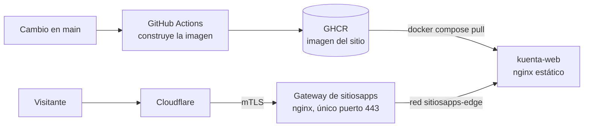

# Publicación del sitio

Decisiones A, B y C del Módulo 15. Este sitio se publica en `https://kuenta.sitiosapps.com` en el VPS del autor. Es una **página estática**: no tiene base de datos, ni cuentas de usuario, ni datos reales.

## Cómo llega el sitio a internet

| Pieza | Qué hace |
|---|---|
| GitHub Actions | En cada cambio a `main` en `docs/`, `diagramas/`, `sitio/` o `infraestructura/sitio/`, construye la imagen y la publica en GHCR. En un pull request solo comprueba que la imagen se construye |
| GHCR | Guarda la imagen `ghcr.io/maomauro/fintech-kuenta-sitio` con las etiquetas `latest` y la del commit |
| `kuenta-web` | Contenedor con nginx que sirve los archivos estáticos. No publica puertos |
| Gateway | Único contenedor que recibe tráfico de fuera. Termina TLS, acepta solo conexiones de Cloudflare y envía a `kuenta-web` por la red `sitiosapps-edge` |
| Cloudflare | DNS y protección delante del gateway |

## A. Decisiones de publicación

| Decisión | Resultado | Motivo |
|---|---|---|
| Dirección | `kuenta.sitiosapps.com`, dentro del dominio paraguas | Cada proyecto recibe un subdominio, no un dominio propio |
| Imagen | Dos etapas: construir con `node:24` y servir con `nginx:1.30-alpine`, la misma versión que el gateway | Misma herramienta que en desarrollo y una imagen pequeña |
| Dónde se construye | En GitHub Actions, nunca en el VPS | El servidor solo ejecuta; no compila |
| Cómo se enruta | Un archivo `kuenta.conf` en el gateway, con el mismo patrón que los demás proyectos (`resolver` más variable en `proxy_pass`) | Si `kuenta-web` no existe, solo falla este sitio y no el gateway |
| Certificado | Certificado de origen de Cloudflare instalado en el VPS | Convención de los demás proyectos |

## B. Cómo se publica

1. Un cambio llega a `main` por pull request.
2. El flujo de trabajo `.github/workflows/publicar-sitio.yml` construye y publica la imagen.
3. En el VPS se ejecuta `docker compose pull && docker compose up -d` dentro de `/srv/sitiosapps/kuenta/`.

El paso 3 es **manual a propósito**. Automatizarlo exigiría guardar una llave SSH en GitHub; es una decisión posterior (ver [pendientes](../modulos/publicacion-y-exposicion.md#estado)).

## C. Endurecimiento

| Medida | Dónde |
|---|---|
| Sistema de archivos de solo lectura y `/tmp` en memoria | `docker-compose.yml` |
| Sin capacidades de Linux salvo las 4 que nginx necesita | `docker-compose.yml` |
| `no-new-privileges` | `docker-compose.yml` |
| Límite de logs (10 MB, 5 archivos) | `docker-compose.yml` |
| Sin puertos publicados al host | `docker-compose.yml` |
| Cabeceras `X-Content-Type-Options`, `Referrer-Policy` y `X-Frame-Options` | `nginx.conf` |
| HSTS y solo conexiones de Cloudflare | Gateway |
| Sin secretos en el repositorio | Todo el repositorio |

## Pasos de la primera publicación

Los hace el autor; el repositorio solo trae los archivos.

1. **Cloudflare:** crear el registro DNS `kuenta` con proxy activado y generar el certificado de origen de `kuenta.sitiosapps.com`.
2. **VPS, certificado:** guardar el certificado como `/etc/nginx/ssl/kuenta.sitiosapps.com.pem` y su llave como `.key`, con la llave en modo 600 y propietario root.
3. **GitHub:** fusionar este módulo a `main` y esperar el flujo `Publicar sitio`. Después, en la página del paquete, cambiar su visibilidad a pública para que el VPS pueda descargarlo sin credenciales.
4. **VPS, contenedor:** crear `/srv/sitiosapps/kuenta/`, copiar allí `infraestructura/sitio/docker-compose.yml` y ejecutar `docker compose pull && docker compose up -d`.
5. **Gateway:** agregar `infraestructura/sitio/gateway/kuenta.conf` como `nginx/conf.d/kuenta.conf` en el repositorio del gateway, por pull request a `develop`. Luego `bash scripts/verificar-config.sh` y `bash scripts/aplicar.sh`.
6. **Comprobar:** abrir `https://kuenta.sitiosapps.com`, verificar `docker ps` (estado `healthy`) y revisar que el puerto 80 de `kuenta-web` no esté publicado.

## Actualizar y volver atrás

| Acción | Comando en `/srv/sitiosapps/kuenta/` |
|---|---|
| Publicar la última versión | `docker compose pull && docker compose up -d` |
| Volver a una versión anterior | `IMAGE_TAG=sha-1234567 docker compose up -d` |
| Ver el estado | `docker ps --filter name=kuenta-web` |

Las etiquetas de cada versión están en la página del paquete en GitHub.

## Costo

El sitio comparte el VPS existente, así que **no agrega costo mensual**. Su imagen ocupa unos pocos megabytes en GHCR, que es gratuito para paquetes públicos.

## Respaldos

El sitio es una copia derivada del repositorio, que ya está en GitHub. No hay datos propios que respaldar en el servidor.

## Verificación

- Las acciones del flujo de trabajo están fijadas por la huella completa de su commit, como recomienda GitHub, con la versión en un comentario. Al actualizarlas hay que cambiar la huella y el comentario.
- Se probó `docker build` en local y el arranque con sistema de archivos de solo lectura y sin capacidades extra: `/salud` responde 200, la portada 200 y una ruta inexistente 404.
