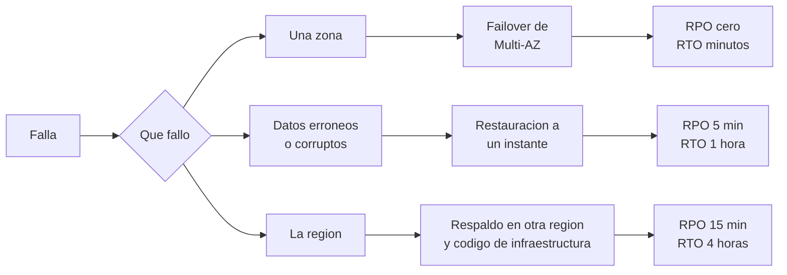

# Plan de recuperación

Decisión B del Módulo 10: **qué se hace cuando algo grande falla**, por escenario.

## B1. Objetivos

- **RPO** (cuántos datos se pueden perder, medido en tiempo) y **RTO** (cuánto puede tardar en volver el servicio).
- La meta de RNF-06 (RPO de 5 minutos y RTO de 1 hora) es una **propuesta propia**, no una norma. Se aplica a los dos primeros escenarios.
- Para la pérdida de una región se decide un objetivo distinto, más relajado, y se explica por qué.

## B2. Escenarios

| Escenario | Mecanismo | RPO | RTO |
|---|---|---|---|
| **1. Caída de una zona de disponibilidad** | Failover automático de RDS Multi-AZ al standby de la otra zona; las tareas de Fargate de la zona sana siguen atendiendo | Sin pérdida (réplica sincrónica) | Minutos. El tiempo real de failover se mide en simulacro |
| **2. Error o corrupción de datos** | Restauración a un instante anterior a una instancia nueva, y luego reapuntar la aplicación; los registros de transacciones se suben cada 5 minutos, así que el último instante restaurable queda típicamente a menos de 5 minutos ([doc](https://docs.aws.amazon.com/AmazonRDS/latest/UserGuide/USER_PIT.html)) | 5 minutos | 1 hora (se mide en simulacro) |
| **3. Pérdida de la región** | **Respaldo y restauración** en otra región: RDS copia a otra región los respaldos y los registros de transacciones ([doc](https://docs.aws.amazon.com/AmazonRDS/latest/UserGuide/USER_ReplicateBackups.html)) y la infraestructura se reconstruye con infraestructura como código (Módulo 11) | 15 minutos | 4 horas |

## B3. Por qué respaldo y restauración para la región

- AWS describe cuatro estrategias: respaldo y restauración, luz piloto, espera tibia (*warm standby*) y activo-activo. Cuanto más cerca de cero el RTO, más cuesta y más complejo es operarlo ([whitepaper](https://docs.aws.amazon.com/whitepapers/latest/disaster-recovery-workloads-on-aws/disaster-recovery-options-in-the-cloud.html)).
- Perder una región entera es raro; con 50.000 clientes y 50 transacciones por segundo de pico, mantener un segundo entorno encendido no se justifica todavía.
- **Decisión:** respaldo y restauración con RTO de 4 horas y RPO de 15 minutos para este escenario. Se reevalúa en el Módulo 12 (costo anual) y en el plan de evolución (Módulo 14), y se registra como ADR en el Módulo 13.
- La copia entre regiones solo está disponible para instancias Multi-AZ, no para clústeres Multi-AZ: otra razón para la decisión del Módulo 8.

## B4. Diagrama de escenarios

Copia editable en draw.io: `modelos/recuperacion/escenarios.drawio`.

## B5. Pasos de la pérdida de región

1. Declarar el desastre (decide el responsable de operación) y abrir un incidente de severidad 1.
2. Restaurar la base de datos desde el respaldo replicado en la región de recuperación.
3. Desplegar la infraestructura y el monolito con el código de infraestructura y la última imagen del contenedor.
4. Validar el libro mayor: recalcular los saldos y comprobar que los apuntes suman cero.
5. Reapuntar el DNS y reactivar las conexiones con terceros.
6. Informar a la Superintendencia y a los clientes si corresponde ([Módulo 9](../seguridad-y-cumplimiento/controles.md)).

## B6. Pendientes

- Tiempo real de failover de Multi-AZ (no se confirmó en documentación oficial; se recuerda de 60 a 120 segundos).
- Cómo llegan los terceros a la región de recuperación: Bre-B, listas y redes pueden exigir direcciones y credenciales propias de cada entorno.
- El costo anual de los respaldos entre regiones y de la transferencia (Módulo 12).
