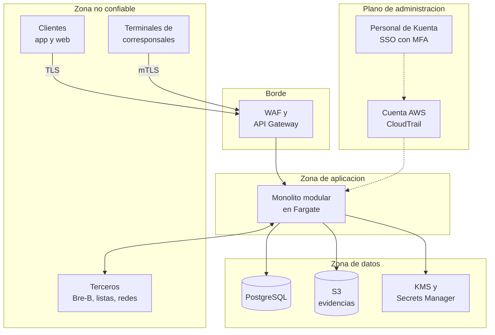

# Modelo de amenazas

Decisión A del Módulo 9: **qué puede salir mal, por dónde y qué lo frena**.

## A1. Método

Se usa [STRIDE](https://learn.microsoft.com/en-us/azure/security/develop/threat-modeling-tool-threats) sobre los flujos de datos. Cada letra es una forma de romper una propiedad de seguridad:

| Letra | Amenaza | Propiedad que rompe |
|---|---|---|
| S | Suplantación (*Spoofing*) | Autenticación |
| T | Alteración (*Tampering*) | Integridad |
| R | Repudio | No repudio |
| I | Divulgación de información | Confidencialidad |
| D | Denegación de servicio | Disponibilidad |
| E | Elevación de privilegios | Autorización |

Las APIs del [Módulo 7](../integracion-y-apis/contratos.md) se revisan además contra el [OWASP API Security Top 10 de 2023](https://api-security.owasp.org/editions/2023/en/0x11-t10/) (ver [controles](./controles.md#mapa-con-owasp-api-security-top-10)).

## A2. Activos

| Activo | Por qué importa |
|---|---|
| Dinero y libro mayor | Es el producto; si no cuadra, no hay negocio (PA-02) |
| Datos personales y biometría | Son sensibles (Ley 1581 de 2012) y su fuga daña a personas |
| Credenciales y llaves | Quien las tiene, actúa como Kuenta |
| Disponibilidad de pagos | Bre-B exige 24/7 y 20 segundos |

## A3. Fronteras de confianza

Cada flecha que cruza una frontera es un lugar donde se pregunta: ¿quién es?, ¿puede hacer esto?, ¿se alteró en el camino?

Copia editable en draw.io: `modelos/seguridad/fronteras-de-confianza.drawio`.

## A4. Amenazas y controles

Riesgo = impacto y probabilidad, **propuesta a validar** (Alto, Medio o Bajo). Los controles se explican en [Controles](./controles.md).

| Id | Dónde | STRIDE | Amenaza | Riesgo | Control principal |
|---|---|---|---|---|---|
| T-01 | App del cliente | S | Toma de una cuenta con credenciales robadas | Alto | Autenticación fuerte, confirmación adicional en operaciones de dinero, aviso de dispositivo nuevo, límite de intentos |
| T-02 | API de clientes | E | Ver o mover el depósito de otra persona cambiando un identificador (OWASP API1) | Alto | Autorización por objeto en cada puerta pública y pruebas que lo verifiquen |
| T-03 | Operaciones de dinero | T | Alterar monto o destino, o repetir una petición | Alto | TLS, `Idempotency-Key`, confirmación adicional ligada a la operación |
| T-04 | Transferencias y retiros | R | El cliente niega haber ordenado la operación | Medio | Auditoría que no se puede alterar y registro de la confirmación adicional |
| T-05 | Terminal de corresponsal | S | Terminal falso, robado o clonado | Alto | mTLS, credencial por terminal revocable, topes por terminal |
| T-06 | Depósito en efectivo | T | Confirmar un depósito que no se recibió | Alto | La autorización vence, conciliación diaria con la red, topes y antifraude |
| T-07 | Libro mayor | T | Modificar apuntes ya escritos | Alto | Sin `UPDATE` ni `DELETE` (Módulo 6), permisos mínimos en la base, recálculo periódico del saldo |
| T-08 | Base de datos y S3 | I | Fuga de datos personales o de evidencias de identidad | Alto | Cifrado con llaves propias, cifrado por campo, datos separados del dinero, S3 sin acceso público |
| T-09 | Registros y eventos | I | Datos personales en registros o eventos | Medio | No se registran; eventos solo con identificadores (Módulo 6) |
| T-10 | API pública | D | Inundación de peticiones o abuso de un flujo de negocio (OWASP API4 y API6) | Medio | WAF, límites por cliente y por terminal, validación contra OpenAPI, escalado automático |
| T-11 | Entrada de Bre-B | S | Orden de pago entrante falsa | Alto | Credenciales y mTLS de Bre-B en ruta aparte, validar cada mensaje, respuesta de rechazo ante duda |
| T-12 | Personal de Kuenta | E | Abuso de privilegios o cuenta administrativa comprometida | Alto | Acceso único con MFA, mínimo privilegio, acceso temporal, separación de funciones, registro |
| T-13 | Entrega de software | T | Dependencia o imagen de contenedor comprometida | Medio | Análisis de dependencias e imágenes en el pipeline (Módulo 11) |
| T-14 | Cuenta de AWS | E | Credenciales de AWS filtradas | Alto | Roles con credenciales temporales (sin llaves largas), cuentas separadas, alarmas sobre CloudTrail |
| T-15 | Atención al cliente | S | Suplantar a un cliente por teléfono para cambiar sus datos | Medio | Verificación reforzada y nunca revelar retenciones de cumplimiento (Módulo 7) |
| T-16 | Credenciales de terceros | I | Fuga de claves de Bre-B, listas o redes | Alto | Secrets Manager, rotación y acceso solo del adaptador dueño |

## A5. Lo que queda fuera

Fraude de negocio (mulas, lavado de activos) no es una amenaza de sistema sino un riesgo del negocio: lo cubre el módulo **Cumplimiento y riesgo** con antifraude básico y SARLAFT. Aquí solo se protege el camino por donde pasa.
